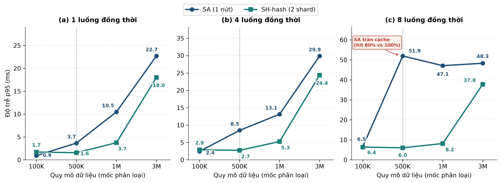
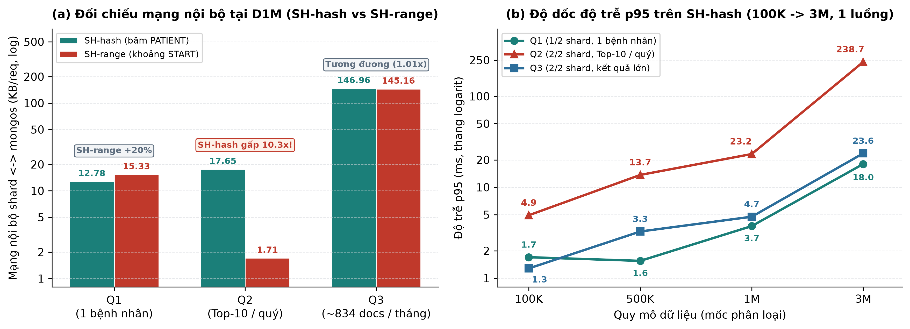

# Phân tích Cơ chế và Đánh giá Thực nghiệm Sharding trên MongoDB 7.0 (Synthea EHR)

> **Báo cáo Bài tập lớn học phần Hệ quản trị Cơ sở dữ liệu (`INT3202 1`)**
> Trường Đại học Công nghệ - Đại học Quốc gia Hà Nội (UET-VNU)

| Thông tin | Chi tiết |
| :--- | :--- |
| **Giảng viên hướng dẫn** | TS. Nguyễn Thị Cẩm Vân |
| **Nhóm thực hiện** | Nhóm 5 - Đỗ Hoàng Đạt (`24020060`), Nguyễn Thị Ngọc Mai (`22025510`), Hoàng Công Thắng (`24022832`) |
| **Hệ quản trị khảo sát** | MongoDB 7.0 Community LTS (`mongo:7.0.48`), Docker cô lập tài nguyên (`1 GB` RAM / `512 MB` WiredTiger Cache / `2 vCPU` mỗi nút) |
| **Báo cáo chính thức (PDF)** | **[Xem / Tải `report/main.pdf`](report/main.pdf)** *(51 trang, biên soạn LaTeX theo mẫu UET-VNU)* |

---

## 1. Tóm tắt Câu hỏi Nghiên cứu và Kết quả Chính

Đề tài khảo sát cơ chế hoạt động bên trong và đánh giá thực nghiệm kỹ thuật **Horizontal Sharding** trên **MongoDB 7.0** với tập dữ liệu hồ sơ bệnh án điện tử **Synthea EHR** qua bốn mốc quy mô lồng nhau theo bệnh nhân (`D100K` $\subset$ `D500K` $\subset$ `D1M` $\subset$ `D3M`, từ `100,000` đến `3,000,000` lượt khám, nạp nối tiếp theo thứ tự thời gian thực `START`). Toàn bộ `114` lượt đo chính thức được chạy tuần tự trên cùng một máy chủ vật lý, lặp 3 lần độc lập, tách biệt pha làm nóng `20s` và kiểm soát CPU máy sinh tải dưới `75%` (`max = 37.9%`).

| RQ | Trọng tâm | Cấu hình & Truy vấn | Phát hiện định lượng chính |
| :--- | :--- | :--- | :--- |
| **RQ1** | Mở rộng đọc & Ngưỡng quy mô | `SA` (1 nút) vs `SH-hash` (2 shard); `Q1` qua `100K -> 3M` ở `1 / 4 / 8` luồng | Ở `100K` (nằm gọn trong RAM), `SA` nhanh hơn gần `2x` ở 1 luồng (`0.92` vs `1.70 ms`). Từ `500K` khi `SA` tràn cache (`hit ~80%`), `SH-hash` giữ `hit 100%`, giảm `p95` tới **`8.66x`** (8 luồng), tăng thông lượng **`3.34x`** tại `1M` và **`1.29x`** tại `3M`. |
| **RQ2** | Độ đều dữ liệu & Tải ghi mới | `SA`, `SH-hash` (`PATIENT`), `SH-range` (`START, PATIENT`) tại `1M` (4 luồng, 60s) | `SH-hash` phân bố đều cả dữ liệu (`49.77% / 50.23%`) lẫn lượt ghi mới (`50.31% / 49.69%`), triệt tiêu điểm nóng ghi **`100% / 0%`** trên Shard 1 của `SH-range` và giữ độ lệch chuẩn `p95` ổn định gấp **`18x`** (`12.71 ± 0.29 ms` vs `10.20 ± 5.36 ms`). |
| **RQ3** | Tỉa mảnh & Chi phí xuyên mảnh | `SH-hash` vs `SH-range` tại `1M` trên `Q1`, `Q2`, `Q3` (+ độ dốc `100K -> 3M` trên `SH-hash`) | `SH-hash` tỉa mảnh `1/2` cho `Q1` (giảm `24.7%` `p95` so với `SH-range`). Ngược lại, trên tổng hợp Top-10 `Q2`, `SH-hash` nhanh hơn `45.9%` ở 1 luồng nhờ quét song song nhưng chịu **lưu lượng mạng nội bộ `shard <-> mongos` cao gấp `10.3x`** (`17.65` vs `1.71 KB/req`, khuếch đại `17.76x`). Với `Q3` (kết quả lớn), băng thông `145 - 436 KB/req` đến từ kích thước tập kết quả (`O(result size)`). |

### Biểu đồ kết quả tiêu biểu

| Mở rộng đọc theo quy mô (`RQ1` - Hình 4.1) | Chi phí mạng nội bộ & Độ dốc `p95` (`RQ3` - Hình 4.4) |
| :---: | :---: |
|  |  |

---

## 2. Cấu trúc Kho lưu trữ

```text
DBMS-distributed-method-benchmarking/
├── README.md                        # Trang tổng quan dự án và hướng dẫn tái lập
├── requirements.txt                 # Thư viện Python cần thiết (pymongo, matplotlib, numpy)
├── infra/
│   └── docker/
│       ├── docker-compose.yml       # Cụm MongoDB 7.0.48 cô lập tài nguyên (SA, SH-hash, SH-range)
│       └── init-cluster.sh          # Khởi tạo Replica Set và cấu hình Sharded Cluster
├── data/
│   ├── DATASET_SUMMARY.json         # Thống kê tập dữ liệu Synthea EHR gốc (100K - 3M)
│   └── V2_ANALYSIS.json             # Thống kê kích thước BSON, cửa sổ thời gian và độ chọn lọc
├── scripts/
│   ├── build_datasets.py            # Chuyển đổi Synthea CSV sang JSONL 9 trường (encounters)
│   ├── verify_datasets.py           # Kiểm chứng số lượng bản ghi và tính lồng nhau 100K - 3M
│   ├── prepare_v2.py                # Tạo bộ tham số truy vấn và gói nạp sắp theo START
│   ├── load_dataset.py              # Nạp nối tiếp các gói dữ liệu kèm metadata thời gian nạp
│   ├── bench_v2.py                  # Script đo thực nghiệm (TN1, TN2, TN3) & thu thập telemetry
│   └── run_all_local.py             # Kịch bản điều phối tự động 3 pha (SA, SH-hash, SH-range)
├── analysis/
│   ├── generate_arch_figures.py     # Sinh 3 hình vẽ kiến trúc vector (SVG -> PNG/PDF) Chương 1 & 2
│   ├── generate_report_artifacts.py # Tổng hợp summary_tables.json và vẽ 4 biểu đồ Chương 4
│   └── summary_tables.json          # Toàn bộ số liệu tổng hợp chính thức từ 114 lượt đo
├── results/                         # Dữ liệu đo gốc đầy đủ (CSV từng request + JSON telemetry)
│   ├── RQ1/                         # Kết quả TN1 (SA vs SH-hash, 100K -> 3M, 1/4/8 luồng)
│   ├── RQ2/                         # Kết quả TN2 (phân bố dữ liệu dist/ + tải ghi 4 luồng)
│   ├── RQ3/                         # Kết quả TN3 (kế hoạch thực thi explain/ + đo Q1, Q2, Q3)
│   ├── load/                        # Metadata thời gian nạp từng mốc dữ liệu
│   └── sys/                         # Nhật ký thực thi các pha benchmark
└── report/                          # Báo cáo LaTeX chuẩn UET-VNU và tệp PDF đã biên dịch
    ├── main.pdf                     # Báo cáo hoàn chỉnh (51 trang)
    ├── main.tex                     # Tệp nguồn LaTeX chính
    ├── build.sh                     # Script biên dịch nhanh ra main.pdf (XeLaTeX / pdfLaTeX)
    ├── cover/                       # Trang bìa ngoài, bìa trong, tóm tắt, từ viết tắt
    ├── chapter/                     # Mở đầu và Chương 1 - Chương 5
    ├── appendix/                    # Phụ lục A (Hạ tầng & Telemetry) và Phụ lục B (Schema & Truy vấn)
    └── figures/                     # 7 hình vẽ vector (PDF cho LaTeX, PNG hiển thị web)
```

> **Ghi chú ánh xạ tên truy vấn trong tệp kết quả gốc:** Trong báo cáo (`report/main.pdf`), ba truy vấn đọc được đánh số liên tục là `Q1`, `Q2`, `Q3`. Để giữ nguyên vẹn 100% tệp đo gốc trong `results/RQ3/` và `scripts/bench_v2.py`, hai truy vấn `Q2` và `Q3` trong báo cáo tương ứng với khóa tệp gốc `Q3` và `Q4`.

---

## 3. Hướng dẫn Tái lập

### Yêu cầu môi trường
- **Docker** và **Docker Compose** (chạy container `mongo:7.0.48` với giới hạn cgroup v2).
- **Python 3.10+** cùng các thư viện trong `requirements.txt`.
- *(Tùy chọn)* `librsvg` (`rsvg-convert`) nếu muốn biên dịch lại SVG kiến trúc, và `TeX Live` (`xelatex`) nếu muốn biên dịch lại `report/main.pdf`.

### Các bước thực thi

```bash
# 1. Cài đặt thư viện Python
pip install -r requirements.txt

# 2. (Từ dữ liệu đo sẵn trong results/) Tổng hợp lại bảng số liệu và vẽ lại toàn bộ biểu đồ
python3 analysis/generate_arch_figures.py
python3 analysis/generate_report_artifacts.py

# 3. Biên dịch lại báo cáo LaTeX -> report/main.pdf
cd report && ./build.sh
```

Để chạy lại toàn bộ 3 pha thực nghiệm từ đầu sau khi chuẩn bị tập Synthea EHR tại `data/`:

```bash
# Chuẩn bị bộ tham số truy vấn và gói nạp tăng dần theo thứ tự thời gian START
python3 scripts/prepare_v2.py --data-root data workload
python3 scripts/prepare_v2.py --data-root data loadorder --tmp-dir data/.tmp

# Điều phối tự động toàn bộ 3 pha (SA, SH-hash, SH-range) trên Docker
python3 scripts/run_all_local.py
```
