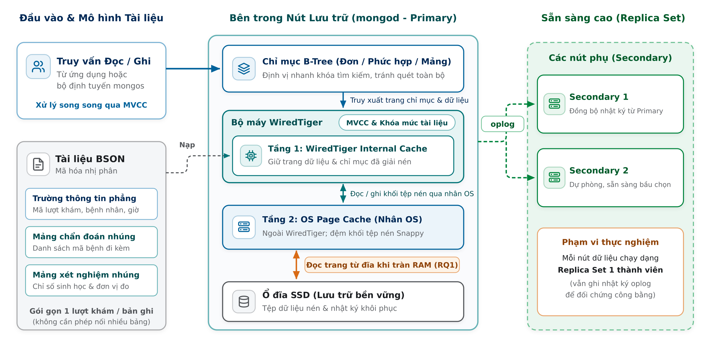
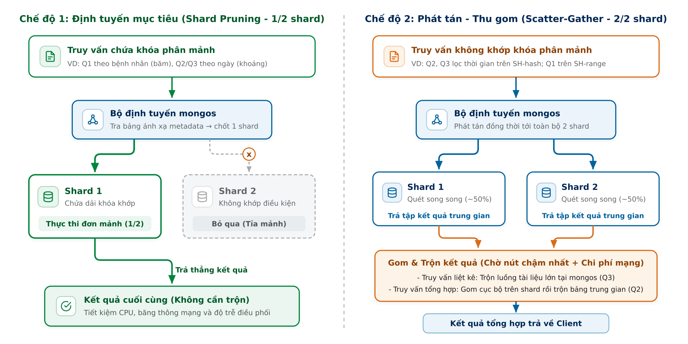
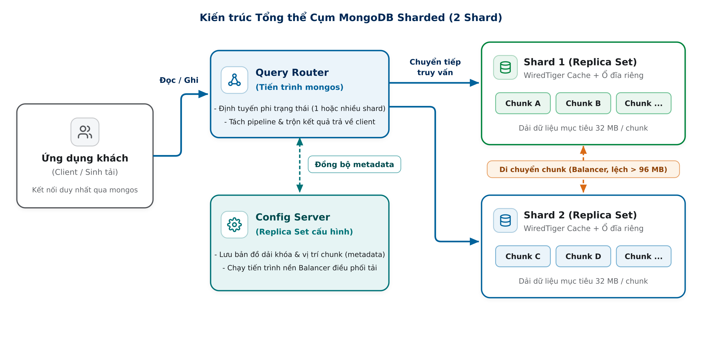
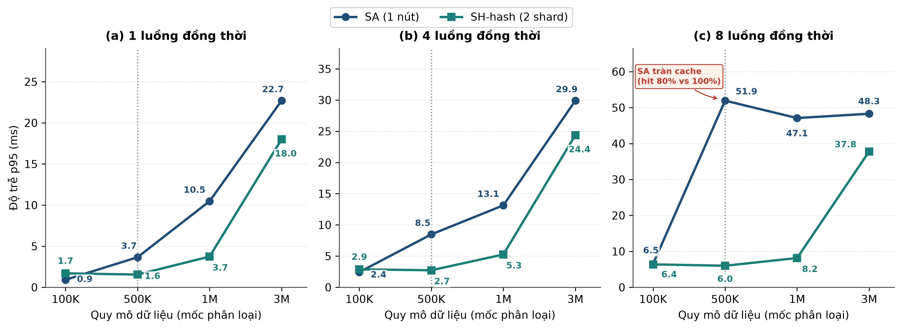
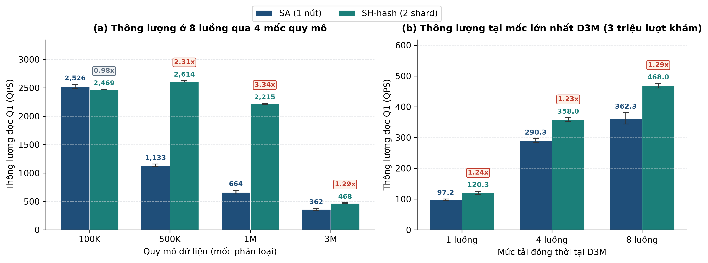
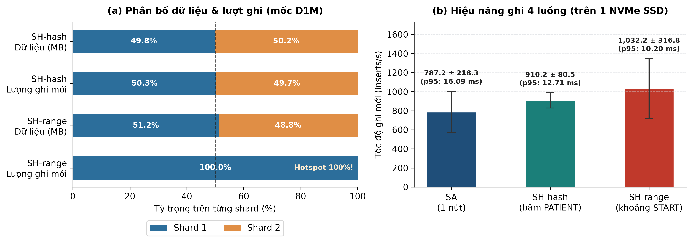
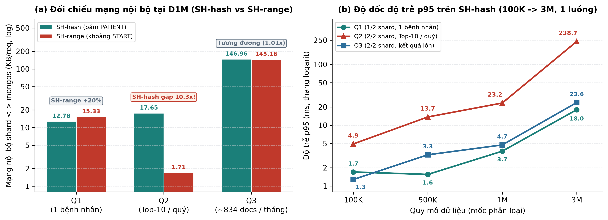

# Phân tích Cơ chế và Đánh giá Thực nghiệm Sharding trên MongoDB 7.0 với Dữ liệu Hồ sơ Bệnh án Điện tử (Synthea EHR)

> [!NOTE] Trạng thái bản thảo
> Bản Markdown này đã được chỉnh sửa hoàn chỉnh theo toàn bộ góp ý rà soát (chuẩn hóa bộ truy vấn `Q1, Q2, Q3`, nhóm Bảng 4.1 theo số luồng kèm chỉ số bộ nhớ đệm, bổ sung Bảng 4.4 cho độ dốc `100K -> 3M`, cấu trúc lại hình vẽ và phân tích `RQ2`/`RQ3`), đồng bộ hoàn toàn sang mã nguồn LaTeX (`report/main.pdf`).

- **Kho lưu trữ GitHub:** https://github.com/DatHoang-git/DBMS-distributed-method-benchmarking
- **Mẫu LaTeX:** UET-VNU (`report/main.tex` -> `report/main.pdf`)

---

## Thông tin Trang bìa (`cover/bia-ngoai.tex`, `cover/bia-trong.tex`)

- **Nhóm thực hiện:** Nhóm 5
- **Thành viên:**
  - Đỗ Hoàng Đạt - `24020060`
  - Nguyễn Thị Ngọc Mai - `22025510`
  - Hoàng Công Thắng - `24022832`
- **Lớp học phần:** `INT3202 1`
- **Giảng viên hướng dẫn:** TS. Nguyễn Thị Cẩm Vân

---

## Tóm tắt (`cover/tom-tat.tex`)

Sự tăng trưởng nhanh chóng của dữ liệu hồ sơ bệnh án điện tử (*Electronic Health Records - EHR*) đặt ra thách thức mở rộng hiệu năng đọc và ghi vượt quá giới hạn phần cứng của một máy chủ cơ sở dữ liệu đơn lẻ. Đề tài này phân tích cơ chế hoạt động bên trong và đánh giá thực nghiệm kỹ thuật phân mảnh ngang phân tán (*Horizontal Sharding*) trên **MongoDB 7.0 Community** với tập dữ liệu tổng hợp Synthea EHR qua bốn mốc quy mô lồng nhau từ $100{,}000$ đến $3{,}000{,}000$ lượt khám bệnh, được nạp tăng dần theo thứ tự thời gian thực.

Về mặt lý thuyết, báo cáo làm rõ kiến trúc cụm phân mảnh của MongoDB 7.0, cơ chế định tuyến và tỉa mảnh truy vấn (*Shard Pruning*) cho cả thao tác tìm kiếm lẫn tổng hợp dữ liệu, sự khác biệt giữa phân mảnh theo hàm băm và phân mảnh theo khoảng, cũng như cơ chế cân bằng theo dung lượng mới của MongoDB 7.0. Về mặt thực nghiệm, cả ba cấu hình cốt lõi (nút đơn lẻ làm mốc đối chứng, cụm hai shard chia băm theo mã bệnh nhân và cụm hai shard chia khoảng theo thời gian khám) được triển khai tuần tự trên **cùng một máy chủ vật lý** thông qua các container Docker cô lập chặt chẽ bộ nhớ RAM và năng lực CPU trên từng nút dữ liệu, tách bạch hoàn toàn pha làm nóng khỏi pha đo lường và đo đồng thời lưu lượng mạng phía máy khách lẫn lưu lượng nội bộ giữa các shard với bộ định tuyến.

Nghiên cứu tập trung trả lời ba câu hỏi: thứ nhất, dữ liệu và mức tải đồng thời đạt tới ngưỡng nào thì cụm hai shard bắt đầu đọc nhanh hơn một nút đơn; thứ hai, chiến lược chia băm và chia khoảng phân bố dung lượng lưu trữ cùng lưu lượng ghi mới đồng đều đến mức nào và tốc độ ghi khác biệt ra sao; và thứ ba, chi phí về độ trễ lẫn lưu lượng mạng nội bộ giữa truy vấn chỉ hỏi một shard so với truy vấn phải phát tán qua cả hai shard khác biệt ra sao khi quy mô tăng dần. Kết quả thực nghiệm cho thấy ở quy mô nhỏ nằm gọn trong RAM đệm ($100{,}000$ lượt khám), nút đơn nhanh hơn cụm chia băm gần gấp đôi ở tải đơn luồng nhờ tránh được bước định tuyến trung gian; nhưng ngay từ mốc $500{,}000$ lượt khám khi nút đơn bắt đầu tràn bộ nhớ đệm, cụm hai shard giữ tỷ lệ trúng bộ nhớ đệm đạt $100\%$, giảm độ trễ đuôi tới $8.66\times$ ở tải 8 luồng và duy trì lợi thế thông lượng tới mốc $3{,}000{,}000$ bản ghi. Ở chiều ghi, chia băm rải đều cả dữ liệu ($49.77\% / 50.23\%$) lẫn lượt ghi mới ($50.31\% / 49.69\%$), triệt tiêu hoàn toàn điểm nóng ghi $100\%$ dồn vào một shard của chia khoảng và giảm biến thiên độ trễ đuôi tới $18\times$; tuy nhiên trên môi trường một ổ NVMe dùng chung, độ lệch chuẩn tốc độ ghi giữa các lần lặp lớn nên chưa ghi nhận khác biệt thông lượng ghi trung bình có ý nghĩa thống kê. Đối với truy vấn xuyên mảnh, chia băm tận dụng quét song song giúp truy vấn tổng hợp đạt thông lượng cao hơn $45.9\%$ so với chia khoảng ở tải đơn luồng, nhưng phải trả giá bằng **lưu lượng mạng nội bộ giữa shard và bộ định tuyến cao gấp $10.3\times$** do không thể cắt bớt kết quả trung gian trước bước trộn cuối; ngược lại, ở truy vấn liệt kê kết quả lớn, lưu lượng mạng tăng tuyến tính lên tới hơn $435\text{ KB/req}$ trên cả hai chiến lược do bản chất kích thước dữ liệu trả về chứ không phải chi phí xuyên mảnh.

**Từ khóa:** *MongoDB 7.0, Horizontal Sharding, Shard Pruning, Synthea EHR, Cơ sở dữ liệu phân tán, Đánh giá hiệu năng.*

---

## Danh mục các từ viết tắt (`cover/viet-tat.tex`)

| Viết tắt | Tiếng Anh | Giải nghĩa |
| :--- | :--- | :--- |
| **BSON** | Binary JSON | Định dạng nhị phân biểu diễn tài liệu trong MongoDB. |
| **CSRS** | Config Server Replica Set | Cụm máy chủ cấu hình lưu metadata định tuyến của cụm sharded. |
| **DBMS** | Database Management System | Hệ quản trị cơ sở dữ liệu. |
| **EHR** | Electronic Health Record | Hồ sơ bệnh án điện tử. |
| **MVCC** | Multi-Version Concurrency Control | Cơ chế kiểm soát tương tranh đa phiên bản. |
| **OLAP** | Online Analytical Processing | Tải truy vấn phân tích, tổng hợp dữ liệu diện rộng. |
| **OLTP** | Online Transaction Processing | Tải giao dịch trực tuyến tốc độ cao, truy cập điểm. |
| **QPS** | Queries Per Second | Thông lượng truy vấn mỗi giây. |
| **RDBMS** | Relational DBMS | Hệ quản trị cơ sở dữ liệu quan hệ. |
| **RQ** | Research Question | Câu hỏi nghiên cứu (`RQ1`-`RQ3`). |
| **SA** | Standalone | Môi trường MongoDB chạy đơn nút (Replica Set một thành viên). |
| **WT** | WiredTiger | Bộ máy lưu trữ mặc định của MongoDB. |

---

# Mở đầu (`chapter/Chap0_MoDau.tex`)

## 1. Bối cảnh và Lý do chọn đề tài

Trong các hệ thống thông tin y tế hiện đại, dữ liệu hồ sơ bệnh án điện tử (*Electronic Health Records - EHR*) mang hai đặc trưng nổi bật: tính **bán cấu trúc** (*semi-structured*) và tốc độ tăng trưởng liên tục theo thời gian [Freire2016]. Khác với bảng quan hệ truyền thống có tập cột cố định, mỗi lượt khám bệnh có thể đi kèm số lượng mã chẩn đoán và kết quả xét nghiệm biến thiên lớn. Khi khối lượng hồ sơ tích lũy qua nhiều năm vượt quá bộ nhớ đệm RAM của một máy chủ đơn lẻ, hiệu năng hệ thống suy giảm rõ do tần suất đọc/ghi ổ cứng tăng cao và hiện tượng tranh chấp tài nguyên xử lý.

Giải pháp mở rộng theo chiều dọc (*scale-up* - nâng cấp phần cứng trên cùng một máy chủ) sớm chạm trần chi phí và giới hạn vật lý. Do đó, mở rộng theo chiều ngang thông qua phân mảnh dữ liệu phân tán (*Horizontal Sharding*) trở thành giải pháp kiến trúc quan trọng trong các hệ quản trị cơ sở dữ liệu NoSQL hiện đại [Cattell2011, Kleppmann2017]. Tuy nhiên, chia dữ liệu ra nhiều máy không tự động làm hệ thống nhanh hơn trong mọi tình huống: hệ thống luôn phải đánh đổi giữa lợi ích chia tải bộ nhớ đệm, CPU và ổ đĩa với chi phí đi qua bộ định tuyến trung gian, rủi ro điểm nóng ghi (*write hotspot*), chi phí di chuyển cân bằng dữ liệu [Liu2012] và chi phí thu gom kết quả của các truy vấn phải quét nhiều mảnh dữ liệu (*cross-shard queries*).

MongoDB là một trong những hệ quản trị cơ sở dữ liệu hướng tài liệu phổ biến nhất hỗ trợ sẵn cơ chế phân mảnh ngang phân tán [MongoDBSharding]. Việc nghiên cứu cơ chế bên trong của **MongoDB 7.0** và đánh giá thực nghiệm có trọng tâm trên tập dữ liệu y tế Synthea EHR [Walonoski2018] giúp trả lời trực diện ba câu hỏi cốt lõi: *dữ liệu và tải đồng thời lớn đến mức nào thì chia hai shard bắt đầu nhanh hơn một nút đơn, cách chia dữ liệu ảnh hưởng ra sao đến độ đều và tốc độ ghi mới, và cái giá thực tế của truy vấn xuyên mảnh lớn tới đâu*.

## 2. Phạm vi nghiên cứu và Câu hỏi nghiên cứu

Nhằm đi sâu vào bản chất kỹ thuật thay vì dàn trải nhiều công cụ, đề tài chốt phạm vi tập trung vào **một hệ quản trị duy nhất (`MongoDB 7.0 Community`)** và **một bài toán dữ liệu chính (`Synthea EHR`)**, khảo sát qua bốn mốc quy mô lồng nhau theo bệnh nhân từ $100{,}000$ đến $3{,}000{,}000$ lượt khám (`D100K` $\subset$ `D500K` $\subset$ `D1M` $\subset$ `D3M`, tương ứng $1{,}822$ đến $55{,}448$ bệnh nhân) trên ba môi trường đối chứng (`SA`, `SH-hash`, `SH-range`).

| Mã | Trọng tâm | Nội dung câu hỏi nghiên cứu |
| :--- | :--- | :--- |
| **RQ1** | Mở rộng đọc & Ngưỡng quy mô | Dữ liệu lớn đến mức nào (`100K -> 3M` lượt khám) và mức tải đồng thời nào (`1 / 4 / 8` luồng) thì cụm MongoDB hai shard (`SH-hash`) đạt hiệu năng đọc tốt hơn nút đơn (`SA`)? |
| **RQ2** | Phân bố dữ liệu & Tốc độ ghi mới | Giữa chiến lược chia băm theo mã bệnh nhân (`SH-hash`) và chia khoảng theo thời gian (`SH-range`), cách nào phân bố dữ liệu và lưu lượng ghi mới đồng đều hơn giữa hai shard, và tốc độ ghi có cao hơn nút đơn (`SA`) không? |
| **RQ3** | Tỉa mảnh & Chi phí xuyên mảnh | Khi truy vấn khớp khóa chia (chỉ hỏi `1/2` shard - *Shard Pruning*) so với không khớp khóa chia (phải hỏi `2/2` shard - *Cross-shard*), độ trễ `p95` và lưu lượng mạng qua bộ định tuyến khác biệt ra sao, đồng thời chi phí xuyên mảnh tăng như thế nào từ `100K` đến `3M`? |

## 3. Mục tiêu và Nội dung thực hiện

- **Phân tích có hệ thống cơ chế MongoDB 7.0 Sharding:** Phân biệt rõ phân vùng đơn nút với phân mảnh ngang đa nút, giải phẫu quy trình định tuyến và tỉa mảnh cho cả truy vấn tìm kiếm lẫn tổng hợp dữ liệu, so sánh chiến lược chia băm với chia khoảng và cập nhật đúng cơ chế cân bằng theo dung lượng của MongoDB 7.0.
- **Thiết kế và triển khai bộ thực nghiệm tinh gọn, có kiểm soát biến:** Xây dựng ba môi trường cốt lõi (`SA`, `SH-hash`, `SH-range`) bằng container Docker cô lập tài nguyên RAM/CPU chặt chẽ, nạp dữ liệu theo thứ tự thời gian thực, tổng hợp đầy đủ các bảng chỉ số hiệu năng và bộ nhớ đệm tương ứng với ba câu hỏi nghiên cứu.
- **Đề xuất khuyến nghị thiết kế và phân tích giới hạn:** Rút ra hướng chọn kiến trúc và khóa phân mảnh phù hợp cho từng đặc trưng tải EHR, kèm phân tích thẳng thắn các giới hạn thực nghiệm.

## 4. Bố cục của báo cáo

- *Chương 1. Giới thiệu và Triển khai MongoDB:* Kiến trúc nền tảng của MongoDB (mô hình tài liệu, bộ máy lưu trữ WiredTiger, chỉ mục B-Tree, tập bản sao Replica Set) và mô hình triển khai cụm MongoDB 7.0 trên container Docker cô lập tài nguyên.
- *Chương 2. Cơ chế Hoạt động của MongoDB Sharding:* Phân biệt phân vùng đơn nút và phân mảnh đa nút, kiến trúc cụm sharded, cơ chế định tuyến và tỉa mảnh, so sánh chiến lược chia băm với chia khoảng, và cơ chế chia chunk cùng tiến trình cân bằng trong MongoDB 7.0.
- *Chương 3. Phương pháp và Thiết kế Thực nghiệm:* Mô tả dữ liệu Synthea EHR và các lớp dung lượng lưu trữ, bốn mốc quy mô lồng nhau nạp tăng dần theo thời gian thực, bộ ba truy vấn đọc đại diện (`Q1`, `Q2`, `Q3`) cùng tải ghi, ba môi trường đối chứng và cơ sở lựa chọn chỉ số đánh giá chính.
- *Chương 4. Kết quả Thực nghiệm và Phân tích Kỹ thuật:* Các bảng kết quả chi tiết, bốn biểu đồ trực quan và phân tích nguyên nhân dựa trên chỉ số bộ nhớ đệm, kế hoạch thực thi truy vấn và lưu lượng mạng cho `RQ1`, `RQ2`, `RQ3`.
- *Chương 5. Khuyến nghị Thiết kế, Giới hạn Thực nghiệm và Kết luận:* Khung lựa chọn chiến lược phân mảnh theo đặc trưng tải EHR, phân tích giới hạn thực nghiệm và hướng phát triển.
- *Phụ lục A và Phụ lục B:* Thông số kỹ thuật chi tiết của container Docker và máy chủ thực thi, câu lệnh cấu hình MongoDB 7.0 cố định, bảng ánh xạ chỉ số đo đạc sang trường dữ liệu hệ thống, cấu trúc JSON thực tế của bản ghi lượt khám và mã truy vấn hoàn chỉnh.

---

# Chương 1. Giới thiệu và Triển khai MongoDB (`chapter/Chap1_GioiThieuMongoDB.tex`)

## 1.1. Tổng quan kiến trúc nền tảng của MongoDB

### 1.1.1. Mô hình dữ liệu hướng tài liệu

MongoDB là hệ quản trị cơ sở dữ liệu NoSQL hướng tài liệu (*document-oriented DBMS*), phù hợp với dữ liệu bán cấu trúc như hồ sơ bệnh án điện tử [MongoDBSharding, Freire2016]. Đơn vị lưu trữ cơ bản là **tài liệu** (*document*) - cấu trúc khóa-giá trị tương tự JSON, cho phép nhúng trực tiếp mảng hoặc tài liệu con bên trong một bản ghi. MongoDB mã hóa tài liệu dưới dạng nhị phân **BSON** (*Binary JSON*) để hỗ trợ các kiểu dữ liệu chuyên biệt (như ngày giờ, số nguyên 64-bit) và tăng tốc phân tích khi đọc ghi.

Các tài liệu cùng nghiệp vụ được gom vào từng **collection**. Điểm khác biệt căn bản so với mô hình bảng quan hệ truyền thống là các tài liệu trong cùng một collection không bị ép theo một lược đồ cột cứng; nhờ vậy toàn bộ thông tin chẩn đoán và kết quả xét nghiệm của một lượt khám bệnh có thể lưu gói gọn trong một tài liệu thuộc collection `encounters` mà không cần tách nhiều bảng và thực hiện phép nối phức tạp.

### 1.1.2. Bộ máy lưu trữ WiredTiger

Kể từ phiên bản 3.2, **WiredTiger** là bộ máy lưu trữ mặc định của MongoDB [MongoDBWiredTiger], thay thế cho MMAPv1.

- **Kiểm soát tương tranh ở mức tài liệu:** Thay vì khóa ở phạm vi rộng (toàn bộ cơ sở dữ liệu hoặc collection) như MMAPv1, WiredTiger áp dụng cơ chế **kiểm soát tương tranh ở mức tài liệu** (*document-level concurrency control*) kết hợp **kiểm soát tương tranh đa phiên bản** (*Multi-Version Concurrency Control - MVCC*). Nhờ lưu giữ các ảnh chụp dữ liệu (*snapshot*) nhất quán theo phiên bản, các luồng đọc không bị chặn bởi luồng ghi và nhiều luồng ghi trên các tài liệu khác nhau có thể thực thi song song. Để bảo đảm an toàn dữ liệu bền vững, WiredTiger đồng thời ghi nhật ký thao tác trước khi xác nhận và định kỳ mỗi 60 giây thực hiện một đợt ghi đồng bộ toàn bộ các trang dữ liệu đã thay đổi xuống ổ đĩa (*checkpoint*).
- **Cơ chế bộ nhớ đệm hai tầng và mối liên hệ với RQ1:** Hiệu năng đọc của MongoDB phụ thuộc trực tiếp vào hai tầng bộ nhớ đệm trên nút lưu trữ:
  - **WiredTiger Internal Cache:** Vùng RAM nội bộ do tiến trình MongoDB quản lý (mặc định khoảng $50\%$ dung lượng $\text{RAM} - 1\text{ GB}$), lưu các trang dữ liệu và chỉ mục ở dạng *đã giải nén*. Khi vùng đệm này đầy tới $80\%$, hệ thống bắt đầu kích hoạt cơ chế đẩy các trang ít dùng ra khỏi bộ nhớ (*eviction*) để nhường chỗ cho trang mới, và có thể tạm chặn luồng ứng dụng nếu mức chiếm dụng vượt $95\%$.
  - **Filesystem Cache (OS Page Cache):** Vùng bộ nhớ đệm tệp tin của nhân hệ điều hành (nằm bên ngoài tiến trình WiredTiger, tận dụng phần RAM còn dư), lưu các khối tệp dữ liệu ở dạng *còn nén* (nén Snappy với tỷ lệ nén $\sim 2.5\times$-$3\times$), đóng vai trò lớp đệm trung gian giữa WiredTiger Cache và ổ đĩa SSD.

Nếu chỉ giới hạn WiredTiger Internal Cache mà không khống chế tổng dung lượng RAM khả dụng của nút dữ liệu, toàn bộ tệp dữ liệu đã nén vẫn có thể nằm gọn trong bộ nhớ đệm tệp của hệ điều hành mà không phát sinh thao tác đọc ổ cứng thực sự. Vì vậy, thực nghiệm khóa cứng đồng thời cả hai tầng RAM đệm này. Khi tập dữ liệu làm việc thực tế (*working set*) vượt quá sức chứa của cả hai lớp đệm, nút đơn buộc phải đẩy trang cũ và đọc trực tiếp các trang dữ liệu từ ổ đĩa SSD, làm độ trễ tăng vọt và đặt nền móng trực tiếp cho câu hỏi nghiên cứu **RQ1**.

### 1.1.3. Chỉ mục B-Tree và Tập bản sao (Replica Set)

Khi dữ liệu tăng lên hàng triệu bản ghi, việc quét tuần tự toàn bộ collection sẽ tiêu tốn I/O rất lớn; do đó MongoDB tổ chức **chỉ mục B-Tree** (biến thể B+Tree trong WiredTiger) để định vị nhanh vị trí tài liệu theo khóa tìm kiếm. Hệ thống hỗ trợ từ chỉ mục đơn trường, chỉ mục phức hợp nhiều trường (như kết hợp mã bệnh nhân và thời điểm khám) cho đến chỉ mục đa khóa (*multikey index*) đánh trực tiếp trên từng phần tử của mảng nhúng (như mảng mã chẩn đoán). Tuy nhiên, bản thân cây chỉ mục cũng tiêu tốn không gian bộ nhớ và cần nằm trong tập dữ liệu làm việc nóng để duy trì tốc độ tra cứu.

Ở tầng phân tán và quản trị độ tin cậy, **Tập bản sao** (*Replica Set*) là đơn vị kiến trúc cốt lõi của MongoDB, không chỉ đơn thuần dùng để ghi nhật ký thay đổi mà đảm nhiệm bốn vai trò sống còn trong vận hành hệ thống:
1. **Đảm bảo tính sẵn sàng cao và tự động chuyển đổi dự phòng:** Trong một Replica Set gồm nhiều thành viên (thường gồm 1 nút chính **Primary** và 2 nút phụ **Secondary**), mọi thao tác ghi đều đi vào Primary rồi nhân bản bất đồng bộ sang các Secondary thông qua nhật ký thao tác **`oplog`**. Nếu nút Primary gặp sự cố phần cứng hoặc mất kết nối, các thành viên còn lại tự động bầu chọn (theo cơ chế đồng thuận đa số) một nút Secondary lên làm Primary mới chỉ trong vài giây, loại bỏ hoàn toàn điểm lỗi đơn lẻ.
2. **Bảo vệ toàn vẹn dữ liệu đa bản sao:** Khi kết hợp với chính sách xác nhận ghi đa số, một giao dịch ghi chỉ được xác nhận thành công sau khi phần lớn các nút trong tập bản sao đã lưu nhận bản ghi vào nhật ký bền vững, tránh nguy cơ mất dữ liệu khi một máy chủ ngừng hoạt động đột ngột.
3. **Mở rộng năng lực đọc và cô lập tải phân tích:** Trong các hệ thống có lượng truy vấn lớn, ứng dụng có thể điều hướng các truy vấn thống kê hoặc đọc chấp nhận trễ nhẹ sang các nút Secondary để giải phóng tài nguyên CPU và bộ nhớ đệm cho nút Primary tập trung xử lý giao dịch trực tuyến.
4. **Khối cấu thành bắt buộc của cụm phân mảnh:** Trong kiến trúc cụm sharded của MongoDB, bản thân mỗi Shard lưu dữ liệu lẫn cụm máy chủ cấu hình (*Config Server*) đều bắt buộc phải vận hành dưới dạng một Replica Set độc lập, kết hợp trực tiếp khả năng mở rộng ngang (Sharding) với khả năng chịu lỗi (Replication).

Trong phạm vi thực nghiệm của đề tài, để cân đối tài nguyên phần cứng giới hạn và giữ đối chứng công bằng về chi phí ghi nhật ký `oplog` giữa mô hình đơn nút với cụm phân mảnh, mỗi nút dữ liệu được triển khai dưới dạng Replica Set một thành viên. Hình 1.1 tổng hợp lại toàn bộ luồng xử lý và kiến trúc lưu trữ nền tảng của một nút MongoDB.


*Hình 1.1: Kiến trúc nền tảng bên trong một nút lưu trữ MongoDB, minh họa mối liên kết giữa mô hình tài liệu BSON, chỉ mục B-Tree, hai tầng bộ nhớ đệm (WiredTiger Internal Cache và OS Page Cache ngoài WiredTiger) và cơ chế đồng bộ qua nhật ký `oplog`.*

## 1.2. Tổng quan mô hình triển khai thực nghiệm

Thay vì phụ thuộc vào biến động hạ tầng đám mây dùng chung, toàn bộ thực nghiệm trên **MongoDB 7.0 Community** được triển khai trên các môi trường container **Docker** cô lập tài nguyên theo ba nguyên tắc kiến trúc nhằm bảo đảm tính tái lập và kiểm soát biến công bằng:

1. **Tách biệt rạch ròi vai trò các thành phần trên mạng nội bộ riêng:** Mỗi nút dữ liệu, máy chủ cấu hình và bộ định tuyến truy vấn đều được đóng gói thành một tiến trình độc lập giao tiếp qua mạng nội bộ của cụm. Ở cấu hình đối chứng đơn nút, ứng dụng sinh tải kết nối thẳng vào một nút dữ liệu duy nhất; ở hai cấu hình phân mảnh, mọi truy vấn bắt buộc đi qua bộ định tuyến trung gian để phản ánh đúng chi phí điều phối phân tán.
2. **Khống chế đồng nhất tài nguyên RAM và CPU để kích hoạt bài toán tràn bộ nhớ đệm:** Mỗi nút dữ liệu bị giới hạn cứng ở mức $1\text{ GB}$ RAM tổng (trong đó $512\text{ MB}$ dành cho WiredTiger Internal Cache) và $2\text{ vCPU}$. Thiết lập này bảo đảm tại mốc nhỏ $100{,}000$ lượt khám dữ liệu nằm gọn trong bộ nhớ đệm, nhưng từ mốc $500{,}000$ đến $3{,}000{,}000$ lượt khám thì nút đơn bị ép tràn cả hai tầng RAM đệm và phải đọc đĩa, trong khi cụm hai shard chia đôi dung lượng làm việc nên vẫn duy trì được độ phủ bộ nhớ đệm cao hơn ở quy mô trung bình.
3. **Cách ly tiến trình sinh tải và giám sát nghẽn phía máy khách:** Tiến trình sinh tải chạy bên ngoài container trên máy chủ, được kiểm soát chặt chẽ để mức sử dụng CPU máy khách luôn duy trì dưới ngưỡng bão hòa $75\%$. Điều này bảo đảm độ trễ và thông lượng đo được phản ánh chính xác giới hạn của hệ quản trị cơ sở dữ liệu chứ không bị méo do thiếu tài nguyên sinh tải.

Chi tiết kịch bản dựng cụm container, thông số phần cứng từng máy chủ thực thi, cổng dịch vụ và công cụ thu thập chỉ số hệ thống được trình bày đầy đủ tại **Phụ lục A**.

---

# Chương 2. Cơ chế Hoạt động của MongoDB Sharding (`chapter/Chap2_CoCheSharding.tex`)

## 2.1. Bài toán Mở rộng Dữ liệu: Phân vùng Đơn nút và Phân mảnh Đa nút

### 2.1.1. Phân biệt Single-node Partitioning và Multi-node Horizontal Sharding

Trong thực hành thiết kế cơ sở dữ liệu, khi một bảng hoặc collection phình to lên hàng triệu bản ghi, hai khái niệm *Partitioning* (phân vùng bảng trên một máy chủ đơn lẻ trong RDBMS) và *Horizontal Sharding* (phân mảnh ngang phân tán trên nhiều nút độc lập trong MongoDB) thường bị sử dụng lẫn lộn vì cả hai đều chia nhỏ một tập dữ liệu lớn thành nhiều phần. Việc phân biệt rạch ròi hai cơ chế này là cần thiết vì hai lý do: thứ nhất, xác định rõ đề tài hướng tới bài toán **mở rộng tài nguyên phân tán** (tăng tổng RAM, CPU và băng thông I/O vượt trần một máy) chứ không phải tổ chức vật lý trên cùng một máy chủ; thứ hai, tạo cầu nối khái niệm trực tiếp từ cơ chế tỉa phân vùng cục bộ sang cơ chế tỉa mảnh qua mạng (*Shard Pruning*) ở phần tiếp theo. Bảng 2.1 đối chiếu trực diện hai cơ chế trên bốn khía cạnh kỹ thuật cốt lõi [Cattell2011, Kleppmann2017].

**Bảng 2.1:** Đối chiếu bản chất kỹ thuật giữa Single-node Partitioning và Multi-node Horizontal Sharding.

| Khía cạnh | Single-node Partitioning (RDBMS) | Multi-node Horizontal Sharding (MongoDB) |
| :--- | :--- | :--- |
| **Mục tiêu chính** | Giảm không gian quét chỉ mục/bảng trên cùng một máy chủ; hỗ trợ quản trị vòng đời dữ liệu (xóa nhanh phân vùng cũ, lưu trữ phân tầng). | Vượt trần phần cứng (RAM, CPU, Disk I/O) của một máy chủ đơn lẻ bằng cách chia tải ra nhiều nút độc lập (*scale-out*). |
| **Phạm vi tài nguyên** | Toàn bộ phân vùng dùng chung CPU, RAM, bộ nhớ đệm và kênh I/O của một nút vật lý. | Mỗi mảnh (*shard*) sở hữu tiến trình lưu trữ, bộ nhớ đệm WiredTiger, hạn mức CPU và (khi triển khai đa máy chủ) ổ đĩa riêng biệt. |
| **Cơ chế định tuyến** | Bộ tối ưu hóa truy vấn cục bộ loại bỏ phân vùng không khớp ngay trong cùng tiến trình cơ sở dữ liệu. | Bộ định tuyến trung gian (`mongos`) đọc metadata cụm để chuyển tiếp yêu cầu qua mạng tới đúng shard đích. |
| **Chi phí phát sinh** | Chi phí lập kế hoạch thấp; không phát sinh độ trễ mạng giữa các phân vùng. | Phát sinh chi phí mạng qua tầng định tuyến, đồng bộ metadata và gom kết quả xuyên nút khi truy vấn không khớp khóa phân mảnh. |

### 2.1.2. Tối ưu phạm vi truy vấn phân tán: Cơ chế Shard Pruning

Trong kiến trúc phân mảnh ngang đa nút của MongoDB, nguyên lý loại bỏ các mảnh không liên quan là **Shard Pruning** (định tuyến mục tiêu - *Targeted Routing*) [MongoDBExplain], phân chia truy vấn đọc thành hai chế độ thực thi cơ bản (minh họa trực quan ở Hình 2.1):

- **Truy vấn định tuyến mục tiêu (Targeted / 1-shard):** Khi điều kiện lọc chứa đầy đủ khóa phân mảnh (hoặc tiền tố phù hợp của khóa phân mảnh theo khoảng), bộ định tuyến `mongos` tra bảng ánh xạ và chỉ gửi truy vấn tới đúng shard chứa dải khóa khớp. Lưu ý rằng việc tỉa mảnh hoạt động ở **cấp độ shard chứ không phải cấp độ chunk**: một truy vấn theo khoảng có thể quét qua nhiều chunk liên tiếp, nhưng nếu toàn bộ các chunk đó cùng cư trú trên một shard duy nhất, truy vấn vẫn chỉ nhắm vào đúng 1 shard và trả kết quả trực tiếp về máy khách mà không phát sinh bước trộn.
- **Truy vấn phát tán-thu gom (Scatter-Gather / Multi-shard):** Khi điều kiện lọc không chứa khóa phân mảnh (hoặc khoảng giá trị vắt ngang biên phân bổ giữa nhiều shard), `mongos` buộc phải phát tán yêu cầu đến tất cả các shard liên quan rồi thu gom, trộn kết quả. Đối với truy vấn tìm kiếm liệt kê thông thường, các shard gửi luồng tài liệu phù hợp về cho `mongos` hợp nhất (hoặc sắp xếp trộn). Đối với truy vấn tổng hợp dữ liệu, bộ tối ưu tách quy trình xử lý làm hai nửa: phần tính toán sơ bộ (lọc, bung mảng, gom nhóm) chạy song song trên từng shard, sau đó gửi tập kết quả trung gian về điểm trộn (tại `mongos` hoặc một shard chỉ định) để hoàn tất bước tổng hợp cuối cùng.


*Hình 2.1: Cơ chế hoạt động của định tuyến mục tiêu (chỉ hỏi 1/2 shard khi khớp khóa phân mảnh) so với phát tán-thu gom (hỏi cả 2/2 shard và phát sinh chi phí trộn kết quả).*

## 2.2. Kiến trúc cụm Sharded của MongoDB

Một **cụm phân mảnh** (*Sharded Cluster*) của MongoDB gồm ba thành phần phối hợp chặt chẽ (Hình 2.2) [MongoDBSharding]:
- **Shard:** Mỗi shard là một Replica Set độc lập lưu trữ một tập con dữ liệu của toàn cụm. Toàn bộ thao tác đọc ghi sau khi được định tuyến đều thực thi trực tiếp trên bộ máy lưu trữ WiredTiger của các shard liên quan.
- **Config Server:** Một Replica Set chuyên biệt lưu giữ toàn bộ **metadata** của cụm, bao gồm bản đồ ánh xạ dải khóa sang từng shard, danh sách collection đã bật phân mảnh, các tham số cấu hình cụm và lịch sử di chuyển dữ liệu.
- **Query Router (`mongos`):** Tiến trình trung gian không lưu trữ dữ liệu người dùng (*stateless router*) tiếp nhận kết nối từ ứng dụng khách, tải metadata định tuyến từ Config Server vào bộ nhớ đệm cục bộ, chuyển tiếp truy vấn tới đúng shard mục tiêu và điều phối luồng kết quả trả về.

Dựa trên giá trị của **Khóa phân mảnh** (*Shard Key*), MongoDB quản lý không gian khóa theo các dải liên tục gọi là **Chunk** (hay *Range*) với dung lượng mục tiêu cấu hình được (cố định $32\text{ MB}$ trong thực nghiệm này). Tiến trình nền **Balancer** chạy trên nút chính của Config Server theo dõi độ chênh lệch dung lượng giữa các shard và điều phối di chuyển dữ liệu khi cần thiết. Khi một chunk được sao chép xong sang shard mới, các bản sao cũ còn sót lại trên shard nguồn được gọi là **bản ghi mồ côi** (*orphaned documents*) và sẽ được MongoDB xóa dọn ở nền (*orphan cleanup*).


*Hình 2.2: Kiến trúc tổng thể cụm MongoDB Sharded gồm Query Router (`mongos`), Config Server lưu metadata định tuyến, hai Shard lưu trữ các dải chunk $32\text{ MB}$ và luồng di chuyển cân bằng tải của Balancer.*

## 2.3. Cơ chế định tuyến, Chiến lược Shard Key và Cân bằng tải (MongoDB 7.0)

### 2.3.1. Quy trình định tuyến và Phân rã độ trễ truy vấn

Với truy vấn đơn shard, độ trễ đo phía máy khách xấp xỉ thời gian thực thi tại shard đích cộng thêm một chặng mạng nội bộ và chi phí định tuyến của `mongos`. Ngược lại, với truy vấn xuyên 2 shard, bộ định tuyến chỉ có thể trả kết quả sau khi nhận đủ phản hồi từ cả hai nút, nên tổng độ trễ bị chi phối bởi nút phản hồi chậm nhất (*straggler effect* - hiệu ứng nút kéo chậm) cộng chi phí truyền tải và trộn kết quả tại điểm hợp nhất:

$$T_{\text{total}} \approx \max\big(T_{\text{shard1}},\, T_{\text{shard2}}\big) + T_{\text{network + merge}}$$

Với các truy vấn phân tích cần quét khối lượng lớn tài liệu nhưng chỉ trả về rất ít dòng kết quả (như thống kê Top-10 mã bệnh `Q2`), việc chia đôi không gian quét và thực thi song song trên hai shard có thể làm giảm đáng kể hạng tử $\max(T_{\text{shard1}}, T_{\text{shard2}})$ - tạo ra sự đánh đổi trực tiếp giữa *Shard Pruning* (giảm số shard tham gia) và *Parallel Scan* (quét song song).

### 2.3.2. So sánh chiến lược Hashed Sharding và Ranged Sharding

- **Hashed Sharding (băm theo mã bệnh nhân `PATIENT`):** Áp dụng hàm băm 64-bit lên mã bệnh nhân. Nhờ chia sẵn không gian băm thành nhiều dải phân bổ đều ngay lúc khởi tạo collection rỗng, cả dung lượng lưu trữ lẫn lưu lượng ghi mới đều được rải đều giữa các shard. Mọi truy vấn chứa điều kiện lọc chính xác theo mã bệnh nhân đều định tuyến vào đúng 1 shard, nhưng các truy vấn lọc theo khoảng thời gian hoặc mã bệnh buộc phải phát tán sang tất cả các shard.
- **Ranged Sharding (khoảng theo thời gian `START` và mã bệnh nhân `PATIENT`):** Chia dải khóa theo thứ tự tăng dần của thời điểm khám `START`. Cách chia này bảo toàn tính cục bộ theo thời gian, giúp các truy vấn báo cáo theo tháng hoặc quý thực hiện *Shard Pruning* triệt để (`1/2` shard). Nhược điểm nghiêm trọng là trong tải ghi trực tuyến với thời gian thực tăng đơn điệu, $100\%$ lưu lượng ghi mới dồn vào dải chứa biên trên vô cực (`MaxKey`) trên **một shard duy nhất** (*Write Hotspot*).

### 2.3.3. Cơ chế chia Chunk, Jumbo Chunk và Tiến trình Balancer trong MongoDB 7.0

Kể từ MongoDB 6.0.3 và hoàn thiện trong **MongoDB 7.0** [MongoDBSharding], cơ chế quản lý chunk và cân bằng tải đã thay đổi căn bản so với các phiên bản cũ [Liu2012], với bốn đặc điểm quan trọng:
1. **Loại bỏ chia chunk tự động khi ghi:** MongoDB 7.0 không còn tự tách chunk ngay lúc chèn dữ liệu; chunk chỉ được tách động tại thời điểm Balancer di chuyển dữ liệu sang shard khác.
2. **Cân bằng theo dung lượng thực tế với ngưỡng $3 \times \text{chunkSize}$:** Balancer so sánh tổng dung lượng dữ liệu giữa các shard và chỉ di chuyển khi độ chênh vượt quá $3 \times 32\text{ MB} = \mathbf{96\text{ MB}}$ ($\sim 7.3\%$ tập `D1M`). Do đó, độ lệch vài phần trăm sau khi Balancer dừng là hành vi thiết kế hợp lệ, không phải lỗi chiến lược phân mảnh.
3. **Hợp nhất chunk tự động (AutoMerger):** Tự động gộp các chunk liền kề trên cùng shard để gọn bảng metadata; vì vậy thước đo độ cân bằng chính xác phải dựa vào dung lượng MB và số bản ghi thực tế trên từng shard thay vì đếm số lượng chunk.
4. **Khái niệm và điều kiện phát sinh Jumbo Chunk:** Một *Jumbo Chunk* (chunk quá khổ không thể tách) là một chunk có dung lượng vượt quá giới hạn mục tiêu ($32\text{ MB}$) nhưng MongoDB không thể chia nhỏ thêm được nữa vì toàn bộ các bản ghi trong đó mang chung một giá trị khóa phân mảnh đơn lẻ (ví dụ một khóa có độ phân biệt quá thấp như giới tính hoặc trạng thái). Khi Jumbo Chunk xuất hiện, Balancer buộc phải bỏ qua và không thể di chuyển nó sang shard khác, gây mất cân bằng dung lượng vĩnh viễn. Trong đề tài này, việc chọn mã bệnh nhân (`PATIENT`) hoặc cặp thời điểm khám kết hợp mã bệnh nhân (`START, PATIENT`) có độ phân biệt cao giúp loại trừ hoàn toàn rủi ro phát sinh Jumbo Chunk.

Trước mọi bài đo đọc và ghi trực tuyến, hệ thống bắt buộc dừng tiến trình Balancer và xác minh cụm không còn bất kỳ phiên di chuyển dữ liệu nào đang chạy (chi tiết câu lệnh kiểm tra chuẩn MongoDB 7.0 xem tại Phụ lục A).

---

# Chương 3. Phương pháp và Thiết kế Thực nghiệm (`chapter/Chap3_ThietKeThucNghiem.tex`)

## 3.1. Dữ liệu Synthea EHR và Thứ tự Nạp Thời gian thực

Dữ liệu hồ sơ bệnh án điện tử được tạo bằng bộ công cụ **Synthea** [Walonoski2018]. Mỗi tài liệu trong collection `encounters` biểu diễn một lượt khám gồm 9 trường thực tế: mã lượt khám, mã bệnh nhân (`PATIENT`), mã cơ sở y tế, loại hình khám, thời điểm bắt đầu (`START`), thời điểm kết thúc, tổng chi phí, mảng mã chẩn đoán và mảng kết quả xét nghiệm. Cấu trúc JSON mẫu đầy đủ được đặt tại **Phụ lục B**.

Đề tài khảo sát **bốn mốc quy mô lồng nhau theo bệnh nhân** (`D100K` $\subset$ `D500K` $\subset$ `D1M` $\subset$ `D3M`) với hạt giống ngẫu nhiên cố định (`SEED = 42`), tổ chức thành bốn gói nạp tăng dần nối tiếp như tổng hợp tại Bảng 3.1.

**Bảng 3.1:** Thống kê bốn mốc dữ liệu Synthea EHR và quan hệ cộng dồn từ các gói nạp tăng dần.

| Mốc tích lũy | Phần dữ liệu cộng dồn | Tổng lượt khám | Tổng số bệnh nhân | BSON giải nén (MB) | Nguồn Gzip (MB) | Số chunk (`32 MB`) |
| :--- | :--- | ---: | ---: | ---: | ---: | ---: |
| `D100K` | Gói 1 (`100,000` khám / `1,822` BN) | 100,000 | 1,822 | 130.3 | 11.44 | ~4.1 |
| `D500K` | Gói 2 (`+400,000` khám / `+7,380` BN) | 500,000 | 9,202 | 656.5 | 70.79 | ~20.5 |
| `D1M` | Gói 3 (`+500,000` khám / `+9,241` BN) | 1,000,000 | 18,443 | 1,309.7 | 144.65 | ~40.9 |
| `D3M` | Gói 4 (`+2,000,000` khám / `+37,005` BN) | 3,000,000 | 55,448 | 3,932.0 | 440.78 | ~122.9 |

Nhìn vào cột nguồn Gzip của Bảng 3.1 (`11.4` đến `440.8 MB`), tập dữ liệu ban đầu có vẻ khá nhỏ so với bộ nhớ RAM; tuy nhiên khi nạp vào MongoDB, dung lượng thực tế quyết định thời điểm tràn bộ nhớ đệm của bộ máy WiredTiger lại phân tách thành ba lớp khác nhau. Bảng 3.2 minh họa cụ thể tỷ lệ giữa ba lớp dung lượng này tại mốc chuẩn `D1M` (`1,000,000` lượt khám, đo trên cấu hình `SH-hash`).

**Bảng 3.2:** Ba lớp dung lượng lưu trữ của bộ máy WiredTiger đo thực tế tại mốc `D1M` (`1,000,000` lượt khám, cấu hình `SH-hash`).

| Lớp dung lượng | Giá trị đo tại `D1M` | Tỷ lệ so với BSON | Vai trò đối với hành vi bộ nhớ đệm |
| :--- | ---: | :---: | :--- |
| **Dữ liệu BSON giải nén** | `1,309.7 MB` | `1.00x` | Trực tiếp chiếm dụng WiredTiger Internal Cache (`512 MB`/nút) và quyết định ngưỡng đẩy trang. |
| **Lưu trữ nén Snappy trên đĩa** | `444.1 MB` | `0.34x` *(nén `2.95x`)* | Chiếm dung lượng tệp thực tế trên ổ SSD và trong OS Page Cache (trên `SA` là `450.9 MB`). |
| **Chỉ mục B-Tree** *(khóa chính + 3 chỉ mục phụ + khóa băm)* | `225.9 MB` | `0.17x` | Chiếm chỗ đồng thời trong bộ nhớ đệm lẫn trên đĩa để định vị nhanh bản ghi (trên `SA` là `212.4 MB`). |

Chính sự chênh lệch dung lượng giữa ba lớp ở Bảng 3.2 lý giải trực tiếp cách chọn bốn mốc quy mô trong Bảng 3.1 để khảo sát câu hỏi nghiên cứu `RQ1` dưới giới hạn $512\text{ MB}$ Internal Cache và $1\text{ GB}$ RAM tổng mỗi nút. Tại mốc `D100K` ($130.3\text{ MB}$ BSON), cả dữ liệu lẫn chỉ mục nằm gọn trong $512\text{ MB}$ Internal Cache của một nút đơn. Ngay khi lên mốc `D500K` ($656.5\text{ MB}$ BSON, chưa tính chỉ mục), nút đơn bắt đầu vượt ngưỡng $512\text{ MB}$ cache nội bộ và buộc phải đẩy trang ra đọc đĩa, trong khi cụm hai shard chia đôi tập dữ liệu (~$328\text{ MB}$/shard) vẫn giữ gọn trong RAM. Đến mốc `D1M` ($1{,}309.7\text{ MB}$ BSON) và đặc biệt là `D3M` ($3{,}932.0\text{ MB}$ BSON cùng hàng trăm MB chỉ mục), tổng dung lượng vượt xa cả hai tầng RAM đệm $1\text{ GB}$ của mỗi nút, đẩy hệ thống sang trạng thái đọc đĩa nặng.

Để bảo đảm bốn mốc dữ liệu lồng nhau hoàn toàn theo danh sách bệnh nhân (`D100K` $\subset$ `D500K` $\subset$ `D1M` $\subset$ `D3M`) mà vẫn sát với tăng trưởng vận hành thực tế, tập lớn nhất `3,000,000` lượt khám được tách thành bốn gói dữ liệu không trùng lặp (Bảng 3.1) để nạp nối tiếp qua từng giai đoạn mà không cắt đôi hồ sơ của cùng một bệnh nhân, đồng thời xóa sạch toàn bộ bản ghi thử phát sinh sau bài đo ghi tại mốc `1M` và thu gọn tệp trước khi nạp tiếp lên `3M`. Thiết kế nạp tăng dần kết hợp sắp xếp lại theo thứ tự thời gian khám `START` bên trong từng gói đem lại ba tác dụng đồng thời: giữ nguyên tập bệnh nhân của mốc nhỏ khi mở rộng quy mô để so sánh độ dốc không bị lệch mẫu; phá vỡ tính cục bộ nhân tạo của tệp Synthea gốc (nơi các lượt khám của cùng một bệnh nhân đứng liền nhau khiến $2{,}000$ dòng đầu của `D1M` chỉ có 48 bệnh nhân, sau khi sắp theo `START` trải rộng ra 414 bệnh nhân với $1{,}697$ lần chuyển bệnh nhân, tái hiện đúng hoạt động ghi xen kẽ theo thời gian thực của bệnh viện); và cho phép cây chỉ mục B-Tree phình to tự nhiên mà chỉ cần nạp một lượt duy nhất $3{,}000{,}000$ bản ghi thay vì xóa đi dựng lại bốn lần.

## 3.2. Ba Môi trường Đối chứng, Truy vấn và Chỉ mục

### 3.2.1. Ba môi trường cốt lõi (MongoDB 7.0)

Để loại bỏ hoàn toàn sai lệch phần cứng, cả ba môi trường đều được chạy tuần tự trên **cùng một máy chủ vật lý** với thông số tài nguyên container khóa cứng đồng nhất:

1. **`SA` (1 nút dữ liệu đơn lẻ):** Một nút dữ liệu chạy dạng Replica Set 1 thành viên; bộ sinh tải kết nối trực tiếp vào nút này (không qua bộ định tuyến trung gian).
2. **`SH-hash` (2 shard - chia băm theo mã bệnh nhân):** Gồm một nút định tuyến `mongos`, một nút Config Server và hai shard dữ liệu đối xứng; collection `encounters` được phân mảnh băm theo `PATIENT` và chia sẵn không gian băm đều ra hai shard ngay từ lúc khởi tạo.
3. **`SH-range` (2 shard - chia khoảng theo thời gian):** Cùng kiến trúc 2 shard như trên, phân mảnh theo khoảng tăng dần của cặp khóa thời điểm khám `START` và mã bệnh nhân `PATIENT`, giữ các bản ghi gần nhau về mặt thời gian trên cùng dải khóa.

Trên mọi nút dữ liệu thuộc ba cấu hình, tài nguyên và chính sách nhất quán được khóa đồng nhất: $512\text{ MB}$ WiredTiger Internal Cache, $1\text{ GB}$ giới hạn RAM tổng, $2\text{ vCPU}$, kích thước chunk $32\text{ MB}$, xác nhận ghi đa số kèm nhật ký đĩa và đọc mức cục bộ (thông số container, máy chủ và câu lệnh cấu hình xem tại Phụ lục A).

### 3.2.2. Ba truy vấn đọc đại diện và bộ chỉ mục đồng nhất

Đề tài xây dựng bộ ba truy vấn đọc đại diện trực tiếp cho các tình huống khai thác dữ liệu EHR thực tế (`Q1`, `Q2`, `Q3`, mã truy vấn chi tiết đặt tại Phụ lục B):

- **`Q1` (Tra cứu theo 1 bệnh nhân - dùng cho `RQ1` và tái sử dụng cho `RQ3`):** Truy xuất toàn bộ lịch sử khám của một bệnh nhân, sắp xếp giảm dần theo thời gian và chỉ chiếu các trường cần thiết. Việc lấy mẫu ngẫu nhiên đều trên $100\%$ danh sách bệnh nhân của từng mốc bảo đảm tập dữ liệu làm việc mở rộng tỷ lệ thuận với quy mô dữ liệu.
- **`Q2` (Thống kê xuyên bệnh nhân, kết quả nhỏ - dùng cho `RQ3`):** Thống kê Top 10 mã bệnh phổ biến nhất trong 1 quý thông qua pipeline tổng hợp (lọc thời gian, bung mảng chẩn đoán, gom nhóm đếm và lấy Top 10). Tại mốc `1M`, mỗi quý quét trung bình $\sim 18{,}300$ lượt khám nhưng chỉ trả về đúng 10 dòng kết quả.
- **`Q3` (Liệt kê xuyên bệnh nhân, kết quả lớn - dùng cho `RQ3`):** Liệt kê các lượt khám cần đánh giá thuốc trong 1 tháng. Tại mốc `1M`, mỗi tháng trả về trung bình $\sim 834$ tài liệu, thể hiện rõ chi phí truyền tải tập kết quả lớn qua mạng.

Ba chỉ mục phụ được tạo đồng nhất trên mọi môi trường trước khi nạp dữ liệu để loại bỏ sai lệch do quét toàn bảng: chỉ mục phức hợp theo bệnh nhân và thời gian cho `Q1`; chỉ mục theo thời gian cho `Q2`; và chỉ mục phức hợp theo mã chẩn đoán và thời gian cho `Q3` (kèm chỉ mục bắt buộc của khóa phân mảnh tương ứng). Đối với `Q2` và `Q3`, cả `SH-hash` và `SH-range` duyệt xoay vòng **cùng một bộ cửa sổ thời gian cố định** (12 quý và 36 tháng trong 3 năm gần nhất), ghi nhận số shard bị chạm như một biến kết quả khách quan.

## 3.3. Thiết kế Ba Thực nghiệm và Cơ sở Lựa chọn Chỉ số Chính

Trước mọi lượt đo đọc (`TN1` và `TN3`), hệ thống luôn chạy riêng một pha làm nóng `20s` trước khi bắt đầu bấm giờ và chụp bộ đếm nội bộ của cơ sở dữ liệu, bảo đảm kết quả thông lượng, độ trễ, bộ nhớ đệm và lưu lượng mạng chỉ phản ánh pha đo ổn định (`30s`). Bảng 3.3 tóm tắt thiết lập của ba thực nghiệm tương ứng với ba câu hỏi nghiên cứu.

**Bảng 3.3:** Thiết kế ba thực nghiệm cốt lõi và chỉ số tổng hợp vào kết quả.

| Mã | RQ | Môi trường & Mốc | Thiết lập chạy & Chỉ số đưa vào kết quả |
| :---: | :---: | :--- | :--- |
| `TN1` | **RQ1** | `SA` vs `SH-hash`; `100K, 500K, 1M, 3M` | Chạy `Q1` ở `1 / 4 / 8` luồng; làm nóng `20s` tách biệt, sau đó đo $\ge 30\text{s}$ và $\ge 2{,}000$ truy vấn, lặp 3 lần. **Bảng 4.1:** `p95` (ms), `QPS`, tỷ lệ trúng bộ nhớ đệm (`%`) và số trang đọc đĩa trên mỗi truy vấn. |
| `TN2` | **RQ2** | `SA`, `SH-hash`, `SH-range`; mốc `1M` | (1) Nạp `1M`, cân bằng ổn định (và thu gọn tệp trên `SH-range`), đọc số bản ghi và tỷ lệ dung lượng MB trên Shard 1 và Shard 2. (2) Tắt Balancer, chạy 4 luồng ghi mới theo thời gian hiện tại trong `60s` lặp 3 lần (dọn sạch bản ghi thử giữa mỗi lần lặp). **Bảng 4.2:** `%` dữ liệu (kèm số bản ghi), `%` lượng ghi mới, `inserts/s`, `p95`. |
| `TN3` | **RQ3** | `SH-hash` vs `SH-range` tại `1M` (+ độ dốc `100K -> 3M` trên `SH-hash`) | Đo đầy đủ cả `Q1`, `Q2`, `Q3` trên cả `SH-hash` và `SH-range` ở 1 luồng (làm nóng `20s` tách biệt, đo $\ge 30\text{s}$, lặp 3 lần tại mọi mốc); thu thập kế hoạch thực thi và đo `15s` lưu lượng nền trên tất cả các nút để tính tách bạch băng thông phía máy khách và băng thông nội bộ giữa các shard với bộ định tuyến. **Bảng 4.3 & Bảng 4.4:** số shard hỏi, `p95`, `QPS`, mạng máy khách, mạng nội bộ (`KB/req`), hệ số khuếch đại và chỉ số đọc đĩa theo quy mô. |

**Lý do chọn mốc chuẩn `D1M` và bước chuẩn bị cho `SH-range` trong `TN2` và `TN3`:** Hai thực nghiệm đối chứng chiến lược phân mảnh (`TN2` và `TN3`) sử dụng mốc chuẩn **`D1M`** (`1,000,000` lượt khám, `1,309.7 MB` BSON) vì ba lý do: (i) quy mô này tạo ra khoảng `41` chunk (`32 MB`), vượt xa ngưỡng cân bằng `96 MB` của MongoDB 7.0 để kích hoạt quá trình di chuyển dữ liệu thực thụ của Balancer giữa hai shard; (ii) quy mô đủ lớn để cả truy vấn điểm (`Q1` đã bắt đầu tràn một phần RAM đệm nội bộ) lẫn truy vấn phân tích theo khoảng thời gian (`Q2` quét `~18,300` bản ghi/quý, `Q3` trả về `~834` bản ghi/tháng) bộc lộ rõ sự khác biệt về tỉa mảnh, độ trễ và băng thông mạng; và (iii) giữ thời gian cân bằng chunk cùng bảo trì lưu trữ trong phạm vi hợp lý. Riêng trên `SH-range`, sau khi nạp `D1M` và để Balancer tự cân bằng sang Shard 2, hệ thống dừng Balancer, hoàn tất dọn bản ghi mồ côi (*orphan cleanup*) và thực hiện thu gọn tệp lưu trữ (*compaction*) trên cả hai shard nhằm loại bỏ phân mảnh đĩa thừa do quá trình di dời chunk trước khi bước vào đo đọc và ghi.

**Cơ sở lựa chọn chỉ số chính:**
- **Cặp `p95` và `QPS` (hoặc `inserts/s`) kèm độ lệch chuẩn (`± std`):** Thông lượng đo sức gánh tổng thể khi nhiều luồng chạy song song, còn `p95` (phân vị $95\%$) đủ nhạy để phát hiện dấu hiệu tràn bộ nhớ đệm/đọc đĩa nhưng ít bị méo bởi ngoại lai đơn lẻ như giá trị trung bình hay `p99`/`Max`. Với các phép đo có độ biến thiên lớn giữa các lần lặp (như ghi trực tuyến `TN2`), báo cáo trình bày tường minh độ lệch chuẩn để phân biệt khác biệt thực chất với nhiễu thống kê.
- **Tách bạch lưu lượng mạng nội bộ (`shard <-> mongos`) và hệ số khuếch đại mạng:** Bộ đếm mạng tại bộ định tuyến chỉ phản ánh lưu lượng trao đổi với máy khách, không cho thấy lượng dữ liệu trung gian mà các shard gửi về bộ định tuyến khi trộn kết quả phân tán. Do đó, thực nghiệm đo tổng lưu lượng mạng đã trừ nền trên cả hai shard (chuẩn hóa theo số truy vấn phía máy khách) và đối chiếu qua **hệ số khuếch đại mạng nội bộ** (tỷ số giữa lưu lượng nội bộ phía shard và lưu lượng phía máy khách) để bắt đúng chi phí xuyên mảnh ẩn.
- **Số trang đọc đĩa trên mỗi truy vấn song song với tỷ lệ trúng bộ nhớ đệm:** Khi hai truy vấn có tổng số trang yêu cầu khác nhau hàng chục lần (như truy vấn điểm `Q1` so với quét theo tháng `Q3`), việc chỉ nhìn tỷ lệ phần trăm trúng bộ nhớ đệm dễ gây ngộ nhận do khác mẫu số. Báo cáo ghi nhận đồng thời **số trang phải đọc từ đĩa trên mỗi truy vấn** làm bằng chứng giải thích trực tiếp.

---

# Chương 4. Kết quả Thực nghiệm và Phân tích Kỹ thuật (`chapter/Chap4_KetQuaThucNghiem.tex`)

Chương này trình bày kết quả thực nghiệm thu thập trên cụm **MongoDB 7.0** triển khai tuần tự trên cùng một máy chủ vật lý theo đúng ba thực nghiệm `TN1`-`TN3` của Chương 3. Toàn bộ $114$ lượt chạy chính thức ($72$ lượt `RQ1`, $9$ lượt `RQ2`, $33$ lượt `RQ3`) đều vượt qua bước tiền kiểm dừng Balancer trước khi đo, đạt $100\%$ truy vấn thành công, không có container nào bị tràn bộ nhớ và có mức sử dụng CPU máy sinh tải cực đại đạt $37.9\% < 75\%$, bảo đảm không phát sinh nghẽn phía máy khách. Mọi số liệu trong các bảng đều là trung bình cộng qua đủ $3$ lần lặp độc lập, tách biệt hoàn toàn pha làm nóng $20\text{s}$ khỏi cửa sổ đo $30\text{s}$.

## 4.1. Kết quả RQ1: Mở rộng Đọc theo Quy mô và Số luồng (`TN1`)

Bảng 4.1 đối chiếu hiệu năng đọc truy vấn `Q1` (đọc toàn bộ lịch sử khám của 1 bệnh nhân) giữa nút đơn (`SA`) và cụm 2 shard chia băm (`SH-hash`), được **nhóm theo từng mức tải đồng thời (`1 / 4 / 8` luồng)** qua bốn mốc quy mô `100K -> 3M`. Bảng trình bày bốn cặp chỉ số chính:
- **`p95` (ms):** Ngưỡng độ trễ đuôi mà $95\%$ truy vấn hoàn tất nhanh hơn (càng thấp càng tốt).
- **`QPS`:** Thông lượng trung bình tính theo số truy vấn hoàn tất mỗi giây (càng cao càng tốt).
- **`Hit cache (%)`:** Tỷ lệ phần trăm trang dữ liệu/chỉ mục tìm thấy sẵn trong WiredTiger Internal Cache mà không cần đọc từ đĩa.
- **`Trang đĩa/req`:** Số trang dữ liệu trung bình phải nạp từ ổ đĩa vào bộ nhớ đệm cho mỗi truy vấn `Q1`.

**Bảng 4.1:** So sánh hiệu năng đọc `Q1` và hành vi bộ nhớ đệm giữa `SA` và `SH-hash`, nhóm theo số luồng đồng thời (`TN1`, trung bình 3 lần lặp).

| Số luồng | Quy mô | `p95` `SA` (ms) | `p95` `SH-hash` (ms) | `QPS` `SA` | `QPS` `SH-hash` | Hit cache `SA / SH` (%) | Trang đĩa/req `SA / SH` |
| :---: | :--- | ---: | ---: | ---: | ---: | :---: | :---: |
| **1** | `100K` | 0.92 | 1.70 | 2,376.4 | 1,198.1 | `100.00 / 100.00` | `0.00 / 0.00` |
| **1** | `500K` | 3.66 | 1.55 | 604.4 | 1,310.0 | `80.66 / 100.00` | `19.21 / 0.00` |
| **1** | `1M` | 10.47 | 3.74 | 212.6 | 537.3 | `64.95 / 79.12` | `34.96 / 20.00` |
| **1** | `3M` | 22.70 | 18.00 | 97.2 | 120.3 | `54.88 / 59.99` | `46.18 / 39.59` |
| **4** | `100K` | 2.44 | 2.88 | 3,215.9 | 2,555.6 | `100.00 / 100.00` | `0.00 / 0.00` |
| **4** | `500K` | 8.48 | 2.73 | 1,238.9 | 2,695.8 | `80.85 / 100.00` | `18.92 / 0.00` |
| **4** | `1M` | 13.13 | 5.26 | 711.0 | 1,574.4 | `64.80 / 79.47` | `35.10 / 19.69` |
| **4** | `3M` | 29.90 | 24.38 | 290.3 | 358.0 | `54.56 / 59.65` | `46.55 / 40.13` |
| **8** | `100K` | 6.52 | 6.38 | 2,525.6 | 2,468.6 | `100.00 / 100.00` | `0.00 / 0.00` |
| **8** | `500K` | 51.93 | 6.00 | 1,133.2 | 2,614.3 | `79.79 / 100.00` | `19.93 / 0.00` |
| **8** | `1M` | 47.09 | 8.15 | 664.0 | 2,214.7 | `64.74 / 79.73` | `35.25 / 19.39` |
| **8** | `3M` | 48.29 | 37.79 | 362.3 | 468.0 | `54.45 / 59.74` | `47.22 / 40.41` |


*Hình 4.1: Đồ thị độ trễ `p95` (ms) của truy vấn `Q1` theo quy mô `100K -> 3M` so sánh `SA` (1 nút) với `SH-hash` (2 shard) ở 1, 4 và 8 luồng đồng thời.*


*Hình 4.2: (a) Diễn biến thông lượng đọc `Q1` (`QPS` kèm `± std`) ở 8 luồng qua bốn mốc `100K -> 3M` cho thấy đỉnh tăng tốc `3.34x` tại `D1M` rồi co hẹp còn `1.29x` tại `D3M`; (b) So sánh thông lượng đọc `Q1` theo 1, 4 và 8 luồng tại mốc lớn nhất `D3M`.*

### Phân tích kỹ thuật RQ1

1. **Vùng dưới ngưỡng hòa vốn (`D100K`) - Chi phí định tuyến `mongos`:** Như thể hiện ở Bảng 4.1, tại `100K` ($130.3\text{ MB}$ BSON), cả `SA` và `SH-hash` đều giữ trọn vẹn dữ liệu trong WiredTiger Internal Cache (`Hit cache = 100.00%`, `0.00` trang đĩa/truy vấn). Khi dữ liệu nằm hoàn toàn trong RAM, `SA` đạt `p95 = 0.92 ms` (`2,376.4 QPS`) ở 1 luồng và `2.44 ms` (`3,215.9 QPS`) ở 4 luồng, vượt trội rõ so với `SH-hash` (`1.70 ms / 1,198.1 QPS` ở 1 luồng; `2.88 ms / 2,555.6 QPS` ở 4 luồng) vì `SH-hash` phải cộng thêm bước băm khóa, định tuyến qua `mongos` và chuyển tiếp qua mạng nội bộ của cụm. Tới 8 luồng tại `100K`, hai cấu hình gần như cân bằng (`6.52` vs `6.38 ms`; `2,525.6` vs `2,468.6 QPS`) khi `SA` bắt đầu chạm giới hạn `2 vCPU` cục bộ.
2. **Mốc giao cắt và bứt phá (`D500K` -> `D1M`) - Tràn bộ nhớ đệm WiredTiger:** Bước ngoặt xảy ra ngay tại **`D500K`** ($656.5\text{ MB}$ BSON cộng chỉ mục đã vượt ngưỡng $512\text{ MB}$ bộ nhớ đệm nội bộ của một nút):
   - Trên `SA`, tỷ lệ trúng bộ nhớ đệm (Bảng 4.1) tụt từ `100%` xuống **`79.79%-80.85%`**, phát sinh **`18.92` đến `19.93` trang phải đọc từ đĩa trên mỗi truy vấn**. Độ trễ `p95` của `SA` tăng vọt từ `2.44 -> 8.48 ms` (4 luồng) và từ `6.52 -> 51.93 ms` (8 luồng).
   - Trái lại, `SH-hash` chia đôi tập dữ liệu (~$328\text{ MB}$ BSON mỗi shard), nên mỗi shard vẫn giữ gọn tập dữ liệu làm việc trong $512\text{ MB}$ bộ nhớ đệm riêng (`Hit cache = 100.00%`, `0.00` trang đĩa/truy vấn). Nhờ vậy `SH-hash` duy trì `p95` cực thấp (`1.55 ms` ở 1 luồng; `2.73 ms` ở 4 luồng; `6.00 ms` ở 8 luồng, thấp hơn `SA` **`8.66x`**) và thông lượng đạt `2,614.3 QPS` (gấp **`2.31x`** `SA`).
   - Tại **`D1M`**, cả hai cấu hình đều bắt đầu tràn bộ nhớ đệm nội bộ nhưng `SH-hash` giữ tỷ lệ trúng quanh **`79.12%-79.73%`** (`19.39-20.00` trang/truy vấn), còn `SA` tụt xuống **`64.74%-64.95%`** (`34.96-35.25` trang/truy vấn). Ở 8 luồng, `SH-hash` đạt `2,214.7 QPS` (`p95 = 8.15 ms`) so với `SA` chỉ còn `664.0 QPS` (`p95 = 47.09 ms`, nhanh hơn **`5.78x`** về độ trễ và **`3.34x`** về thông lượng - đỉnh tăng tốc cao nhất trên Hình 4.2a).
   - **Giải thích việc `p95` 8 luồng của `SA` đạt đỉnh sớm tại `D500K` rồi đi ngang ở `D1M`-`D3M`:** Trên Hình 4.1(c), dù dữ liệu tăng gấp đôi từ `D500K` lên `D1M` và gấp sáu lần lên `D3M`, `p95` của `SA` ở 8 luồng lại đạt đỉnh ngay tại `D500K` (`51.93 ms`) rồi hơi hạ xuống `47.09 ms` (`D1M`) và `48.29 ms` (`D3M`), trong khi hiệu năng tổng thể vẫn giảm đều (thông lượng `QPS` tụt liên tục `1,133.2 -> 664.0 -> 362.3 QPS` và trung vị `p50` tăng đều `2.93 -> 6.06 -> 14.50 ms`). Nguyên nhân nằm ở đặc tính tải vòng kín 8 luồng: tại `D500K`, `SA` vẫn đang xử lý ở tốc độ cao (`1,133 QPS`) ngay vùng vừa chạm ngưỡng đẩy trang (*eviction*), khiến 8 luồng đồng thời tranh chấp mạnh trên 2 vCPU và làm một bộ phận truy vấn bị nghẽn đột ngột phải chờ lâu hơn hẳn mức thông thường (đẩy phân vị `p95` vọt lên `51.93 ms` dù trung vị `p50` mới là `2.93 ms`). Khi dữ liệu lên `D1M` và `D3M`, việc phải đọc `35-47` trang đĩa trên mỗi truy vấn tự động làm chậm tốc độ vòng lặp gửi yêu cầu của 8 luồng, giảm áp lực tranh chấp đẩy trang tức thời nên `p95` chững lại quanh `47-48 ms`.
3. **Vùng tràn bộ nhớ đệm sâu (`D3M`) và ngưỡng bão hòa ổ đĩa dùng chung:** Khi dữ liệu lên chính xác $3{,}000{,}000$ lượt khám ($3.93\text{ GB}$ BSON cộng chỉ mục), số liệu ở Bảng 4.1 cho thấy cả hai cấu hình đều phải đọc đĩa nặng (`SA` chỉ còn `Hit cache = 54.45%-54.88%` với `46.18-47.22` trang đĩa/truy vấn; `SH-hash` là `59.65%-59.99%` với `39.59-40.41` trang đĩa/truy vấn). `SH-hash` tiếp tục vượt `SA` ở cả 3 mức luồng (Hình 4.2b): nhanh hơn `1.24x` thông lượng ở 1 luồng (`120.3` vs `97.2 QPS`), `1.23x` ở 4 luồng (`358.0` vs `290.3 QPS`) và **`1.29x`** ở 8 luồng (`468.0` vs `362.3 QPS`; `p95 = 37.79` vs `48.29 ms`). Biên độ tăng tốc thu hẹp lại so với mốc `D1M` vì hai container shard trên cùng máy chủ chia sẻ chung băng thông ngẫu nhiên của một ổ NVMe vật lý.

---

## 4.2. Kết quả RQ2: Độ đều Dữ liệu và Tốc độ Ghi mới (`TN2`)

Bảng 4.2 đánh giá khả năng cân bằng dữ liệu và tốc độ ghi trực tuyến tại mốc chuẩn `D1M` (`1,000,000` lượt khám, 4 luồng ghi đồng thời theo thời gian hiện tại trong 60 giây, lặp 3 lần độc lập và xóa sạch bản ghi thử giữa mỗi lần lặp). Bảng tổng hợp bốn chỉ số chính:
- **Dữ liệu trên Shard 1 / Shard 2 (`%` và số bản ghi):** Tỷ trọng dung lượng dữ liệu BSON (kèm số lượng bản ghi thực tế từ tổng `1,000,000` lượt khám) lưu trên từng shard sau khi Balancer dừng ổn định.
- **Lượng ghi mới trên Shard 1 / Shard 2 (`%`):** Tỷ lệ thao tác chèn mới thực tế rơi vào từng shard trong 60 giây đo.
- **Tốc độ ghi (`inserts/s`, mean ± std):** Số lượt chèn thành công trung bình mỗi giây kèm độ lệch chuẩn qua 3 lần lặp.
- **Độ trễ ghi `p95` (ms, mean ± std):** Phân vị $95\%$ thời gian hoàn tất một thao tác ghi kèm độ lệch chuẩn qua 3 lần lặp.

**Bảng 4.2:** Phân bố dữ liệu và hiệu năng ghi trực tuyến (4 luồng, 60s, trên cùng một ổ NVMe SSD) tại mốc `D1M` (`TN2`).

| Cấu hình | Dữ liệu: Shard 1 / Shard 2 (`%` / số bản ghi) | Lượng ghi mới: S1 / S2 (`%`) | Tốc độ ghi (`inserts/s`, mean ± std) | Độ trễ ghi `p95` (ms, mean ± std) |
| :--- | :---: | :---: | ---: | ---: |
| `SA` *(1 nút)* | `100.0% / 0.0%` (`1,000,000 / 0`) | `100.0% / 0.0%` | 787.2 ± 218.3 | 16.09 ± 5.24 |
| `SH-hash` *(băm `PATIENT`)* | `49.77% / 50.23%` (`500,182 / 499,818`) | `50.31% / 49.69%` | 910.2 ± 80.5 | 12.71 ± 0.29 |
| `SH-range` *(khoảng `START`)* | `51.22% / 48.78%` (`489,352 / 510,648`) | `100.00% / 0.00%` | 1,032.2 ± 316.8 | 10.20 ± 5.36 |


*Hình 4.3: (a) Tỷ trọng dữ liệu lưu trữ và lượng ghi mới rơi vào Shard 1 vs Shard 2 tại mốc `D1M`; (b) So sánh tốc độ ghi (`inserts/s`, kèm thanh sai số `± std`) và độ trễ `p95` của `SA`, `SH-hash` và `SH-range` trên cùng một ổ NVMe SSD.*

### Phân tích kỹ thuật RQ2

1. **Độ đều dữ liệu, ngưỡng dừng $96\text{ MB}$ của Balancer và chi phí vận hành sau di dời chunk:**
   - Với `SH-hash` (đã chia sẵn dải băm ban đầu), hàm băm 64-bit rải đều bản ghi ngay trong lúc nạp: trong tổng số `1,000,000` lượt khám của `18,443` bệnh nhân tại mốc `D1M`, Shard 1 nhận `500,182` bản ghi (`651.80 MB`, `49.77%`) và Shard 2 nhận `499,818` bản ghi (`657.87 MB`, `50.23%`) - độ chênh lệch chỉ là `364` bản ghi (`0.46%` dung lượng, tức `6.07 MB`), hoàn toàn là dao động ngẫu nhiên tự nhiên của phép băm theo mã bệnh nhân có số lượt khám khác nhau.
   - Trái lại, với `SH-range`, vì toàn bộ dữ liệu nạp tăng dần theo thời gian `START` nên ban đầu cả `1,000,000` lượt khám đều đi vào Shard 1; sau đó tiến trình Balancer mới sao chép `510,648` bản ghi thuộc các khoảng thời gian cũ hơn sang Shard 2 (`638.87 MB`, `48.78%`) và giữ lại `489,352` bản ghi mới hơn trên Shard 1 (`670.79 MB`, `51.22%`). Độ chênh dung lượng cuối cùng giữa hai shard là **`31.92 MB`**, nằm dưới ngưỡng kích hoạt di chuyển $3 \times 32\text{ MB} = \mathbf{96\text{ MB}}$ của MongoDB 7.0 nên Balancer tự dừng.
   - Đáng chú ý, cách cân bằng "nạp dồn rồi di dời" của `SH-range` kéo theo một **chi phí vận hành thực tế mà `SH-hash` không gặp phải**: sau khi Balancer sao chép `510,648` bản ghi cũ sang Shard 2, MongoDB phải xóa toàn bộ `510,648` bản sao cũ đó trên Shard 1 (*orphan cleanup*). Do bộ máy WiredTiger giữ lại không gian trống sau xóa bên trong tệp dữ liệu mà chưa trả ngay cho hệ điều hành, dung lượng tệp nén trên đĩa của Shard 1 bị phình tới `603.99 MB` dữ liệu + `362.97 MB` chỉ mục (gấp gần `2.9x` Shard 2 vốn chỉ tốn `217.76 MB` + `149.29 MB`). Cụm `SH-range` buộc phải chạy thêm thao tác thu gọn tệp (`compact`) để giải phóng `584.4 MB` trên Shard 1 (tổng `630.2 MB` cả cụm theo thống kê tệp), đưa Shard 1 về `264.62 MB` dữ liệu + `117.98 MB` chỉ mục trước khi bước vào đo đọc và ghi.
2. **Điểm nóng ghi tuyệt đối (*Write Hotspot*) trên `SH-range`:** Như phân tích ở trên, sau khi Balancer chia khoảng xong, **Shard 2 giữ các khoảng thời gian cũ hơn**, còn **Shard 1 giữ khoảng thời gian mới nhất chứa biên trên vô cực (`MaxKey`)**. Khi ứng dụng chạy tải ghi trực tuyến với mốc thời gian hiện tại tăng đơn điệu (mọi bản ghi mới đều lớn hơn toàn bộ dữ liệu lịch sử), **`100.00%` thao tác chèn mới trên `SH-range` đều dồn vào Shard 1** và `0.00%` vào Shard 2, tạo ra điểm nóng ghi tuyệt đối. Ngược lại, `SH-hash` phân tán gần như cân bằng tuyệt đối **`50.31% / 49.69%`** sang cả hai shard (Hình 4.3a).
3. **Phân tích độ biến thiên về tốc độ ghi khi các container dùng chung một ổ NVMe SSD:**
   - *Nhận xét về tốc độ ghi trung bình:* Xét riêng giá trị trung bình ở Bảng 4.2, `SH-range` (`1,032.2 ins/s`) và `SH-hash` (`910.2 ins/s`) đều nhỉnh hơn `SA` (`787.2 ins/s`), nhưng do độ lệch chuẩn của `SA` (`± 218.3 ins/s`) và `SH-range` (`± 316.8 ins/s`) rất lớn, khoảng biến động của cả ba cấu hình chồng lấp nhau mạnh (Hình 4.3b). Do đó, không có cơ sở thống kê để kết luận cấu hình nào đạt thông lượng ghi trung bình cao hơn tuyệt đối trong điều kiện dùng chung một ổ đĩa.
   - *Nguyên nhân gây độ lệch chuẩn lớn khi dùng chung một ổ NVMe SSD:* Mỗi lượt chạy ghi kéo dài đúng `60s`, trùng khớp với chu kỳ ghi đĩa định kỳ (*checkpoint* 60 giây) của WiredTiger kết hợp thao tác đồng bộ nhật ký bền vững (`fsync`) xuống cùng một ổ NVMe vật lý. Ở cả `SA` và `SH-range`, `100%` lưu lượng ghi dồn vào **một tiến trình WiredTiger duy nhất**: khi chu kỳ xả checkpoint và bộ đệm ghi nhanh (SLC cache) của NVMe đang thuận lợi (như lần lặp 3 của `SH-range`), tốc độ vọt lên `1,389.3 ins/s` (`p95 = 4.06 ms`); ngược lại khi đợt xả checkpoint và đồng bộ nhật ký chồng lên nhau trên cùng một nút, hàng đợi ghi đĩa bị nghẽn cục bộ khiến tốc độ tụt xuống `600-785 ins/s` (`p95 = 13.9-22.0 ms`).
   - *Kết luận chắc chắn rút ra được từ `TN2`:* Dù giới hạn một ổ SSD vật lý chưa cho phép đo trọn lợi thế nhân đôi băng thông ghi tối đa của `SH-hash`, thực nghiệm vẫn chứng minh chắc chắn **hai lợi thế thực chất của `SH-hash`**: (a) triệt tiêu hoàn toàn điểm nóng ghi (`50.31%/49.69%` thay vì `100%/0%`), và (b) **giảm mạnh độ biến thiên hiệu năng ghi** - độ lệch chuẩn tốc độ ghi thu hẹp gần `4x` (`± 80.5` vs `± 316.8 ins/s` của `SH-range`) và độ lệch chuẩn độ trễ đuôi `p95` ổn định hơn tới **`18x`** (`12.71 ± 0.29 ms` so với `10.20 ± 5.36 ms` của `SH-range` và `16.09 ± 5.24 ms` của `SA`) nhờ chia đôi áp lực ghi và hàng đợi trang bẩn sang hai bộ nhớ đệm độc lập.

---

## 4.3. Kết quả RQ3: Tỉa mảnh và Chi phí Truy vấn Xuyên mảnh (`TN3`)

Phần này trả lời câu hỏi `RQ3` theo hai mục tiêu tách bạch: (1) **đối chiếu trực tiếp `SH-hash` và `SH-range` tại mốc chuẩn `D1M`** trên cả ba truy vấn `Q1`, `Q2`, `Q3` (Bảng 4.3 và Hình 4.4a); và (2) **khảo sát độ dốc hiệu năng và lưu lượng mạng khi quy mô tăng `30x` (`100K -> 3M`) trên `SH-hash`** (Bảng 4.4 và Hình 4.4b). Toàn bộ lượt đo chạy ở 1 luồng đồng thời, trung bình 3 lần lặp đã trừ pha làm nóng và trừ lưu lượng nền 15 giây nhàn rỗi trên tất cả các nút.

Trước khi đọc số liệu ở Bảng 4.3, ý nghĩa của các chỉ số đo đạc được định nghĩa như sau:
- **`Shard hỏi`:** Số shard thực sự tham gia thực thi truy vấn theo kế hoạch thực thi (`explain`): `1 / 2` là truy vấn được tỉa mảnh (định tuyến mục tiêu), còn `2 / 2` là truy vấn phải phát tán xuyên mảnh. Để dễ so sánh, mỗi cặp truy vấn trong Bảng 4.3 đều xếp cấu hình tỉa mảnh (`1 / 2`) ở dòng trên và cấu hình xuyên mảnh (`2 / 2`) ở dòng dưới.
- **`p95` (ms) & `QPS`:** Độ trễ đuôi phân vị $95\%$ và thông lượng truy vấn mỗi giây đo phía máy khách.
- **Mạng máy khách (`KB/req`):** Lưu lượng mạng trung bình trao đổi giữa ứng dụng sinh tải và bộ định tuyến `mongos` cho mỗi truy vấn (phản ánh kích thước yêu cầu và kết quả cuối cùng trả về ứng dụng).
- **Mạng nội bộ shard (`KB/req`):** Tổng lưu lượng mạng trung bình mà cả hai shard trao đổi với `mongos` cho mỗi truy vấn (phản ánh lượng dữ liệu trung gian truyền trong nội bộ cụm trước khi `mongos` trộn kết quả).
- **Hệ số khuếch đại mạng:** Tỷ số `Mạng nội bộ shard / Mạng máy khách`. Giá trị càng gần `1.0x` chứng tỏ dữ liệu chuyển trong nội bộ cụm gần bằng đúng kết quả trả về máy khách; giá trị càng lớn cho thấy chi phí truyền dữ liệu trung gian ẩn bên trong cụm càng cao.

**Bảng 4.3:** Đối chiếu khả năng tỉa mảnh, hiệu năng và chi phí mạng nội bộ giữa `SH-hash` và `SH-range` tại mốc `D1M` (`TN3`, 1 luồng, trung bình 3 lần lặp; xếp `1 / 2` trên, `2 / 2` dưới cho từng truy vấn).

| Truy vấn | Cấu hình | Shard hỏi | `p95` (ms) | `QPS` | Mạng máy khách (KB/req) | Mạng nội bộ shard (KB/req) | Hệ số khuếch đại |
| :--- | :--- | :---: | ---: | ---: | ---: | ---: | :---: |
| `Q1` *(1 BN)* | `SH-hash` | 1 / 2 | 3.74 | 537.3 | 12.23 | 12.78 | 1.05x |
| `Q1` *(1 BN)* | `SH-range` | 2 / 2 | 4.97 | 412.4 | 12.20 | 15.33 | 1.26x |
| `Q2` *(Top-10/quý)* | `SH-range` | 1 / 2 | 31.53 | 36.2 | 0.99 | 1.71 | 1.74x |
| `Q2` *(Top-10/quý)* | `SH-hash` | 2 / 2 | 23.18 | 52.8 | 0.99 | 17.65 | 17.76x |
| `Q3` *(~834 docs/tháng)* | `SH-range` | 1 / 2 | 5.66 | 238.3 | 144.21 | 145.16 | 1.01x |
| `Q3` *(~834 docs/tháng)* | `SH-hash` | 2 / 2 | 4.74 | 298.0 | 144.21 | 146.96 | 1.02x |

**Bảng 4.4:** Diễn biến hiệu năng, mạng nội bộ và đọc đĩa của `Q1`, `Q2`, `Q3` trên `SH-hash` qua bốn mốc quy mô `100K -> 3M` (1 luồng, trung bình 3 lần lặp).

| Truy vấn | Quy mô | `p95` (ms) | `QPS` | Mạng nội bộ (KB/req) | Hit cache (%) | Trang đĩa/req |
| :--- | :--- | ---: | ---: | ---: | ---: | ---: |
| `Q1` *(1/2 shard)* | `100K` | 1.70 | 1,198.1 | 12.93 | 100.00 | 0.00 |
| `Q1` *(1/2 shard)* | `500K` | 1.55 | 1,310.0 | 12.89 | 100.00 | 0.00 |
| `Q1` *(1/2 shard)* | `1M` | 3.74 | 537.3 | 12.78 | 79.12 | 20.00 |
| `Q1` *(1/2 shard)* | `3M` | 18.00 | 120.3 | 12.71 | 59.99 | 39.59 |
| `Q2` *(2/2 shard)* | `100K` | 4.92 | 301.9 | 14.01 | 100.00 | 0.00 |
| `Q2` *(2/2 shard)* | `500K` | 13.66 | 101.8 | 17.32 | 100.00 | 0.00 |
| `Q2` *(2/2 shard)* | `1M` | 23.18 | 52.8 | 17.65 | 100.00 | 0.00 |
| `Q2` *(2/2 shard)* | `3M` | 238.73 | 10.7 | 17.46 | 97.63 | 1,928.64 |
| `Q3` *(2/2 shard)* | `100K` | 1.28 | 1,271.8 | 16.67 | 100.00 | 0.00 |
| `Q3` *(2/2 shard)* | `500K` | 3.26 | 466.6 | 75.04 | 100.00 | 0.00 |
| `Q3` *(2/2 shard)* | `1M` | 4.74 | 298.0 | 146.96 | 100.00 | 0.00 |
| `Q3` *(2/2 shard)* | `3M` | 23.58 | 83.5 | 435.82 | 94.59 | 207.90 |


*Hình 4.4: (a) Đối chiếu trực tiếp lưu lượng mạng nội bộ (`shard <-> mongos`, thang logarit) giữa `SH-hash` và `SH-range` trên cả ba truy vấn `Q1`, `Q2`, `Q3` tại mốc chuẩn `D1M`; (b) Độ dốc độ trễ `p95` (thang logarit, ms) của `Q1`, `Q2` và `Q3` trên `SH-hash` qua bốn mốc `100K -> 3M` (1 luồng).*

### Phân tích kỹ thuật RQ3

1. **Khả năng tỉa mảnh trái ngược giữa hai chiến lược và cái giá trên `Q1` của `SH-range`:** Hai chiến lược phân mảnh cho hiệu quả tỉa mảnh hoàn toàn ngược nhau theo loại truy vấn: chiến lược nào tỉa mảnh tốt cho truy vấn theo bệnh nhân (`Q1`) thì bắt buộc phải quét cả hai shard cho truy vấn theo khoảng thời gian (`Q2`, `Q3`), và ngược lại:
   - `SH-hash` tỉa mảnh **100%** cho truy vấn bệnh nhân `Q1` (`1/2` shard, không cần trộn), nhưng buộc phải phát tán **100%** (`2/2` shard) cho mọi cửa sổ `Q2` (`12/12` quý) và `Q3` (`36/36` tháng).
   - Ngược lại, `SH-range` mất tỉa mảnh hoàn toàn cho `Q1` (`5/5` mẫu kiểm tra đều phải phát tán và sắp xếp trộn trên `2/2` shard), làm `p95` tăng **`+32.9%`** (`4.97` vs `3.74 ms`), thông lượng giảm **`23.2%`** (`412.4` vs `537.3 QPS`) và lưu lượng mạng nội bộ tăng thêm `20.0%` (`15.33` vs `12.78 KB/req`, hệ số khuếch đại `1.26x` so với `1.05x`). Đổi lại, `SH-range` đạt tỷ lệ tỉa mảnh **100%** trên cả `12/12` quý của `Q2` và `36/36` tháng của `Q3` (`1/2` shard) vì 3 năm dữ liệu gần nhất nằm trọn trên Shard 1.
2. **Đánh đổi cốt lõi của `Q2`: Tốc độ quét song song (`+45.9%` `QPS`) đối lấy khuếch đại mạng nội bộ (`10.3x`):**
   - Nhờ tách pipeline tổng hợp để chạy song song phần lọc, bung mảng và gom nhóm sơ bộ trên cả hai shard (`2 vCPU` mỗi shard), ở tải 1 luồng `SH-hash` đạt độ trễ `p95` thấp hơn (`23.18` vs `31.53 ms`) và thông lượng cao hơn **`45.9%`** (`52.8` vs `36.2 QPS`) so với `SH-range` vốn dồn toàn bộ việc quét `~18,300` bản ghi/quý lên một shard duy nhất. Cần lưu ý rằng lợi thế quét song song này chỉ phát huy trọn vẹn khi cụm còn dư CPU trên shard còn lại (tải 1 luồng); dưới tải đồng thời cao hoặc hỗn hợp `Q1` + `Q2`, cơ chế phát tán `2/2` shard của `SH-hash` sẽ tiêu thụ CPU trên cả hai shard cho mỗi truy vấn tổng hợp.
   - Quan trọng hơn, nếu chỉ nhìn lưu lượng phía máy khách (`0.99 KB/req` ở cả hai cấu hình), ta sẽ bỏ sót hoàn toàn cái giá phân tán ẩn: trong pipeline của `Q2`, bước giới hạn Top 10 (`$limit: 10`) không thể đẩy xuống trước bước gom nhóm cuối cùng ở `mongos`, buộc mỗi shard của `SH-hash` phải truyền toàn bộ bảng gom nhóm mã bệnh trung gian về `mongos`. Kết quả là lưu lượng mạng nội bộ giữa shard và `mongos` của `SH-hash` vọt lên **`17.65 KB/req`** (hệ số khuếch đại **`17.76x`**), **cao gấp `10.3x`** so với `SH-range` (`1.71 KB/req`, hệ số `1.74x`, Hình 4.4a). Trong cụm sản xuất đa máy chủ với nhiều truy vấn OLAP chạy đồng thời, chính lưu lượng trung gian này sẽ tiêu hao băng thông mạng cụm và CPU trộn của `mongos`.
3. **Phân biệt bản chất chi phí mạng của `Q3` (kết quả lớn):**
   - Ở `Q3` (liệt kê `~834` lượt khám/tháng tại `1M` mà không cần sắp xếp toàn cục), ở tải 1 luồng `SH-hash` (`2/2` shard) đạt thông lượng nhỉnh hơn `SH-range` (`298.0` vs `238.3 QPS`, `p95 = 4.74` vs `5.66 ms`) do tận dụng được song song 2 shard và chỉ truyền thẳng luồng tài liệu không qua bước sắp xếp trộn.
   - Quan trọng hơn, Hình 4.4(a) và Bảng 4.3 cho thấy lưu lượng mạng nội bộ của `SH-hash` và `SH-range` trên `Q3` **gần như đồng nhất** (`146.96` vs `145.16 KB/req`, hệ số khuếch đại chỉ `1.01x - 1.02x`). Điều này chứng minh rõ rằng sự bùng nổ băng thông của `Q3` qua các mốc quy mô trong Bảng 4.4 (`16.67 KB/req` ở `100K` -> `75.04 KB/req` ở `500K` -> `146.96 KB/req` ở `1M` -> **`435.82 KB/req`** ở `3M`) là **chi phí kích thước tập kết quả trả về (`O(result size)`)**, hoàn toàn không phải chi phí khuếch đại do phát tán xuyên mảnh.
4. **Lý giải độ dốc `p95` của `Q1`, `Q2`, `Q3` từ `100K` đến `3M` trên `SH-hash`:**
   - Từ Bảng 4.4 và Hình 4.4(b), khi dữ liệu tăng $30\times$ (`100K -> 3M`), `Q2` có độ dốc dốc nhất (`4.92 -> 13.66 -> 23.18 -> 238.73 ms`, tăng **`48.5x`**) vì số lượt khám trong mỗi quý tăng tuyến tính theo quy mô và tới mốc `D3M` phải đọc trung bình **`1,928.64` trang đĩa trên mỗi truy vấn** (tỷ lệ trúng bộ nhớ đệm giảm còn `97.63%`), dù lưu lượng mạng nội bộ đi ngang quanh `14.0-17.6 KB/req` do số lượng mã bệnh phân biệt trong bảng gom nhóm tăng chậm.
   - Tại mốc `D3M`, `Q3` có `p95 = 23.58 ms` (`83.5 QPS`) gần với `Q1` (`18.00 ms`, `120.3 QPS`) dù `Q3` đọc trung bình **`207.90` trang đĩa/truy vấn** (nhiều gấp `5.3x` so với `39.59` trang đĩa/truy vấn của `Q1`, Bảng 4.4). Lý do `Q3` vẫn giữ được độ trễ tương đương nằm ở hai cơ chế: thứ nhất, chỉ mục phức hợp của `Q3` tập trung trong $36$ cửa sổ tháng gần nhất nên các trang đọc đĩa mang **tính cục bộ và tuần tự cao** (đồng thời tái sử dụng nóng giữa 36 cửa sổ); thứ hai, `Q3` chạy song song trên hai shard trong khi `Q1` truy cập ngẫu nhiên rải rác trên toàn bộ $55{,}448$ bệnh nhân qua nhiều thập kỷ (`Hit cache = 59.99%`), gây đọc đĩa ngẫu nhiên tốn kém hơn trên mỗi trang. Tuy vậy, trên mạng Docker nội bộ tốc độ cao, việc truyền `435.8 KB/req` của `Q3` mới chỉ tiêu tốn vài mili-giây; trong cụm liên máy chủ thực tế qua mạng TCP/Ethernet, băng thông mạng lớn của `Q3` sẽ khuếch đại độ trễ đáng kể hơn.

---

# Chương 5. Khuyến nghị Thiết kế, Giới hạn Thực nghiệm và Kết luận (`chapter/Chap5_KhuyenNghiKetLuan.tex`)

## 5.1. Khung Khuyến nghị Thiết kế Sharding cho Hệ thống EHR

Từ cơ chế hoạt động của MongoDB 7.0 ở Chương 2 kết hợp với bằng chứng định lượng từ Chương 4, Bảng 5.1 tổng hợp khung khuyến nghị lựa chọn cấu hình lưu trữ theo đặc trưng tải EHR.

**Bảng 5.1:** Khung khuyến nghị lựa chọn kiến trúc và khóa phân mảnh theo đặc trưng tải EHR.

| Đặc trưng tải EHR | Cấu hình đề xuất | Cơ sở kỹ thuật & Mốc định lượng từ Chương 4 |
| :--- | :--- | :--- |
| Dữ liệu nhỏ nằm gọn trong bộ nhớ đệm 1 nút (`D100K` với cache `512 MB`), tải đọc đơn/đa luồng vừa phải | **1 nút đơn (`SA`)** | Tránh chi phí định tuyến `mongos` và độ trễ mạng nội bộ: tại `D100K`, `SA` nhanh hơn `SH-hash` gần `2.0x` về thông lượng ở 1 luồng (`0.92` vs `1.70 ms`; `2,376.4` vs `1,198.1 QPS`) và vẫn dẫn trước ở 4 luồng (`3,215.9` vs `2,555.6 QPS`). |
| Dữ liệu vượt RAM đệm 1 nút (từ `D500K` trở lên), tải đọc tra cứu bệnh nhân (`Q1`) và ghi mới liên tục | **Hashed Sharding (`SH-hash`)** | Chia đôi tập dữ liệu làm việc và tải CPU: giữ `100%` hit cache tại `D500K` (giảm `p95` tới `8.66x` ở 8 luồng), tăng thông lượng `3.34x` tại `D1M` và `1.29x` tại `D3M` (8 luồng); rải đều dữ liệu (`49.77/50.23%`), triệt tiêu điểm nóng ghi (`50.31/49.69%`) và giữ độ trễ ghi ổn định gấp `18x` (`12.71 ± 0.29 ms`); bảo đảm tỉa mảnh `1/2` cho `Q1` (giảm `24.7%` độ trễ `p95` so với `SH-range`: `3.74` vs `4.97 ms`). |
| Thiên về truy vấn tổng hợp theo khung thời gian (`Q2`) cần giảm băng thông mạng liên nút và cô lập phân vùng dữ liệu cũ/mới, ít ghi trực tuyến đơn điệu | **Ranged Sharding (`SH-range`)** | Tỉa mảnh `100%` (`1/2` shard) cho cả `Q2` và `Q3`, giúp giảm lưu lượng mạng nội bộ giữa shard và `mongos` tới **`10.3x`** trên truy vấn tổng hợp `Q2` (`1.71` vs `17.65 KB/req` ở `D1M`); cần chấp nhận điểm nóng ghi `100%/0%` trên một shard, bất lợi `+32.9%` độ trễ `Q1` và yêu cầu bảo trì thu gọn tệp nếu Balancer di dời nhiều dữ liệu. |

**Lưu ý đối với tải hỗn hợp trong sản xuất:** Nếu hệ thống vừa phục vụ bác sĩ tra cứu bệnh nhân (`Q1`) vừa chạy nhiều báo cáo liệt kê kết quả lớn (`Q3` tiêu thụ `145 - 436 KB/req` kể cả khi tỉa mảnh `1/2` shard), việc tách tải phân tích sang nút phụ chuyên biệt trên Replica Set 3 thành viên hoặc kho phân tích riêng là giải pháp cần thiết để tránh nghẽn băng thông `mongos`, song nằm ngoài phạm vi đo đạc trực tiếp của cụm 1 thành viên mỗi shard trong đề tài này.

## 5.2. Giới hạn Thực nghiệm

Để bảo đảm tính khách quan khoa học và làm rõ phạm vi diễn giải số liệu, báo cáo ghi nhận năm giới hạn cốt lõi:

1. **Triển khai container trên cùng một máy chủ dùng chung ổ NVMe SSD và mạng nội bộ cục bộ:** Việc chạy cả ba cấu hình tuần tự trên cùng một máy chủ vật lý đã loại bỏ hoàn toàn sai lệch phần cứng giữa các môi trường, nhưng hai shard vẫn chia sẻ chung băng thông I/O của một ổ NVMe SSD và truyền dữ liệu qua mạng bridge nội bộ gần như không độ trễ. Điều này khiến tốc độ tăng tốc ở vùng tràn đĩa sâu (`D3M`) thu hẹp xuống `1.29x`, không tách biệt được lợi ích nhân đôi băng thông ghi của hai ổ đĩa độc lập trong `TN2`, đồng thời làm chi phí truyền tải `435.8 KB/req` của `Q3` trên `D3M` nhẹ hơn so với mạng liên máy chủ thực tế.
2. **Chưa đối chứng với phương án nâng cấp dọc trên 1 nút:** Thực nghiệm `TN1` so sánh 1 nút (`1 GB RAM / 2 vCPU`) với cụm 2 shard (`2 GB RAM / 4 vCPU` tổng), trả lời trực diện ngưỡng quy mô để sharding vượt nút đơn cố định cấu hình nhưng chưa tách riêng phần đóng góp của việc nhân đôi RAM cục bộ so với thêm nút thứ hai.
3. **Replica Set 1 thành viên mỗi shard:** Mỗi shard chỉ gồm 1 thành viên nên chính sách xác nhận ghi đa số thực tế tương đương ghi cục bộ kèm nhật ký đĩa, chưa phản ánh độ trễ mạng đồng bộ nhật ký thao tác sang các nút phụ như cụm sản xuất 3 thành viên.
4. **Giới hạn RAM thu nhỏ, tải `TN3` đơn luồng và cửa sổ thời gian 3 năm trên cụm 2 shard:** Mức WiredTiger Internal Cache ($512\text{ MB}$) và RAM nút ($1\text{ GB}$) được thu nhỏ để kích hoạt tràn bộ nhớ đệm ngay ở mốc `500K-3M`; do đó giá trị tuyệt đối (ms) gắn với cấu hình này trong khi xu hướng định tính mang tính khái quát. Ngoài ra, thực nghiệm `TN3` chỉ đo ở 1 luồng đồng thời nên lợi thế quét song song của `SH-hash` trên `Q2`/`Q3` chưa phản ánh áp lực tranh chấp CPU khi nhiều luồng phân tích và giao dịch chạy đồng thời; đồng thời bộ cửa sổ 3 năm gần nhất trên cụm 2 shard chia theo thời gian luôn rơi trọn vào một shard mới hơn (`100%` tỉa mảnh), chưa kiểm chứng trường hợp cửa sổ truy vấn cắt ngang ranh giới chia mảnh.
5. **Dữ liệu tổng hợp Synthea và nạp tuần tự không cập nhật:** Dữ liệu Synthea mô phỏng sát cấu trúc lâm sàng nhưng vẫn là dữ liệu tổng hợp; quy trình nạp nối tiếp theo thời gian không bao gồm chu kỳ cập nhật/xóa kéo dài của bệnh viện thực tế (dù hiện tượng phình tệp lưu trữ do thao tác xóa khi cân bằng dữ liệu đã được quan sát trực tiếp trên `SH-range` và xử lý bằng bước thu gọn tệp trước khi đo).

## 5.3. Kết luận và Hướng phát triển

Đề tài đã phân tích có hệ thống cơ chế phân mảnh ngang của **MongoDB 7.0** và kiểm chứng thực nghiệm trên cùng một máy chủ với dữ liệu Synthea EHR từ `100K` đến `3M` lượt khám, rút ra ba phát hiện định lượng chính:
- **Về mở rộng đọc (`RQ1`):** Sharding bất lợi khi tập dữ liệu làm việc nằm gọn trong bộ nhớ đệm nút đơn (`D100K`, 1 luồng: `SA 0.92 ms` vs `SH-hash 1.70 ms`; 4 luồng: `SA 3,215.9` vs `SH-hash 2,555.6 QPS`). Ngay khi nút đơn chạm ngưỡng tràn bộ nhớ đệm tại `D500K` (`Hit cache ~80%`), `SH-hash` giữ tỷ lệ trúng `100%`, giảm `p95` tới `8.66x` ở 8 luồng (`6.00` vs `51.93 ms`) và duy trì lợi thế thông lượng `3.34x` tại `D1M` và `1.29x` tại `D3M` (`468.0` vs `362.3 QPS`).
- **Về phân bố dữ liệu và tải ghi (`RQ2`):** `SH-hash` phân bố dữ liệu (`49.77/50.23%`) và lượt ghi mới (`50.31/49.69%`) gần như tuyệt đối với độ trễ ghi ổn định hơn `18x` (`12.71 ± 0.29 ms`), triệt tiêu điểm nóng ghi `100%/0%` trên Shard 1 của `SH-range` (cấu hình cũng tuân thủ đúng ngưỡng dừng $96\text{ MB}$ của Balancer MongoDB 7.0 với độ lệch `31.92 MB`). Trên một ổ NVMe dùng chung, độ biến thiên tốc độ ghi giữa các lần lặp lớn nên chưa ghi nhận khác biệt thông lượng trung bình có ý nghĩa thống kê giữa hai chiến lược phân mảnh.
- **Về tỉa mảnh và chi phí xuyên mảnh (`RQ3`):** `SH-hash` và `SH-range` cho khả năng tỉa mảnh trái ngược nhau theo loại truy vấn (`Q1` `1/2` vs `2/2` shard khiến `SH-range` chậm hơn `32.9%` `p95` trên `Q1`; ngược lại `Q2`/`Q3` `2/2` vs `1/2` shard). Khi đo tách bạch lưu lượng mạng nội bộ, thực nghiệm phát hiện sự đánh đổi bản chất: trên truy vấn tổng hợp `Q2` ở tải đơn luồng, `SH-hash` chạy nhanh hơn `45.9%` nhờ quét song song (`52.8` vs `36.2 QPS`) nhưng phải trả giá bằng **lưu lượng nội bộ giữa shard và bộ định tuyến cao gấp `10.3x`** (`17.65` vs `1.71 KB/req`, hệ số khuếch đại `17.76x`), trong khi băng thông lớn của `Q3` (`145 - 436 KB/req`) bắt nguồn từ kích thước tập kết quả trả về chứ không phải chi phí xuyên mảnh.

**Hướng phát triển:**
- Triển khai trên cụm đa máy chủ vật lý hoặc đám mây thực (mỗi shard có ổ SSD và mạng riêng) kèm cấu hình đối chứng nâng cấp dọc (1 nút gấp đôi RAM), tải `TN3` đa luồng và Replica Set 3 thành viên mỗi shard để đo lợi ích băng thông ghi độc lập của `SH-hash`, độ trễ đồng bộ qua mạng cũng như hiệu quả cô lập tải phân tích sang nút phụ.
- Khảo sát khóa phân mảnh băm phức hợp (kết hợp băm mã bệnh nhân với thời gian khám) hoặc phân mảnh theo vùng (*Zone Sharding*) nhằm cân bằng tốt hơn giữa phân tải ghi và tỉa mảnh theo thời gian.

---

# Phụ lục A. Chi tiết Cấu hình Hạ tầng, Lệnh Triển khai và Telemetry (`appendix/AppendixA_CauHinhHaTang.tex`)

Phụ lục này tập trung toàn bộ chi tiết kỹ thuật triển khai đã được lược gọn khỏi phần thân báo cáo nhằm phục vụ tái lập thực nghiệm.

## A.1. Thông số Container Docker và Máy chủ Thực thi

Toàn bộ cả ba cấu hình được thực thi tuần tự trên cùng một máy chủ vật lý để loại bỏ sai lệch phần cứng; kịch bản điều phối tự động được đặt tại `scripts/run_all_local.py` (kèm hướng dẫn tham khảo trong `docs/local/`).

| Hạng mục | Cấu hình áp dụng |
| :--- | :--- |
| **Phiên bản DBMS** | **MongoDB 7.0 Community LTS (`mongo:7.0.48`)** đồng nhất trên mọi container. |
| **Container nút dữ liệu** (`mdb-sa`, `mdb-shard1`, `mdb-shard2`) | Giới hạn cgroup v2 `--memory=1g --cpus=2`, `--wiredTigerCacheSizeGB 0.50` ($512\text{ MB}$), Replica Set 1 thành viên (`rs0`, `shard1RS`, `shard2RS`). |
| **Container điều phối** (`mdb-cfgsvr`, `mdb-mongos`) | `mdb-cfgsvr`: `--memory=512m --cpus=1`, `--wiredTigerCacheSizeGB 0.25` (cổng `27019`); `mdb-mongos`: `--memory=512m --cpus=2` (cổng `27017`); kết nối nội bộ qua mạng Docker bridge `mdb-net`. |
| **Máy host thực thi duy nhất** | `dathoang-NgocTrinh` (EndeavourOS Linux, kernel `7.2.14-arch1-1`, 12th Gen Intel Core i7-12700H 20 CPU logic, 15 GiB RAM, Micron NVMe SSD `MTFDKBA512QFM-1BD1AABGB` 476.9 GB, chạy chế độ nguồn AC ổn định). |
| **Kịch bản chuẩn bị, nạp, chạy & vẽ** | Chuẩn bị dữ liệu sắp theo `START` (`S1..S5`, `D1M_sorted`) trong `data/load_v2/`; nạp nối tiếp bằng `scripts/load_dataset.py`; điều phối tự động sạch 3 pha bằng `scripts/run_all_local.py`; đo bằng `scripts/bench_v2.py` (tách riêng pha làm nóng 20s trước khi lấy mẫu `t0`/`st0`); tổng hợp bảng và hình bằng `analysis/generate_report_artifacts.py`. |
| **Giám sát máy khách & container** | `bench_v2.py` đọc `/proc/stat` giám sát CPU client luôn $< 75\%$ (thực tế `client_cpu_max = 37.9%`, `client_bound: false` trên cả 114 lượt đo); kiểm tra `docker inspect` bảo đảm `OOMKilled: false`, `RestartCount: 0`. |

## A.2. Phân công Container và Cổng Dịch vụ

| Container | Cổng ánh xạ (Host:Container) | Vai trò trong cụm Sharded (`SH-hash`, `SH-range`) | Vai trò trong `SA` |
| :--- | :---: | :--- | :--- |
| `mdb-sa` | `27017:27017` | Không sử dụng. | Chạy 1-node RS (`rs0`), `bench_v2.py` kết nối trực tiếp. |
| `mdb-mongos` | `27017:27017` | Query Router tiếp nhận mọi truy vấn từ `bench_v2.py`. | Không sử dụng. |
| `mdb-cfgsvr` | `27019:27019` | Config Server (`--configsvr --replSet cfgRS`). | Không sử dụng. |
| `mdb-shard1` | `27118:27018` | Shard 1 (`--shardsvr --replSet shard1RS`). | Không sử dụng. |
| `mdb-shard2` | `27218:27018` | Shard 2 (`--shardsvr --replSet shard2RS`). | Không sử dụng. |

## A.3. Tham số MongoDB 7.0 Cố định và Quy trình Chạy Ba Pha

- **Khóa phân mảnh và khởi tạo:** `SH-hash` dùng `{PATIENT: "hashed"}` kèm `{numInitialChunks: 16}`; `SH-range` dùng `{START: 1, PATIENT: 1}`. Collection phụ `patients` phân mảnh theo `{_id: "hashed"}` trên cụm sharded (không sharding ở `SA`).
- **Kích thước Chunk (`rangeSize`):** Cố định `32 MB` qua `{_id: "chunksize", value: 32}` trong `config.settings`.
- **Chính sách đọc/ghi:** Cố định `writeConcern: {w: "majority"}` (trên RS 1 thành viên tương đương `w: 1, j: true`) và `readConcern: {level: "local"}`.
- **Tiền kiểm Balancer chuẩn MongoDB 7.0:** Trước mọi bài đo đọc và ghi trực tuyến, gọi `sh.stopBalancer()` và xác minh qua `db.adminCommand("balancerStatus")` rằng `mode == "off"`, `inBalancerRound == false`, và `config.migrations` rỗng.
- **Dọn sạch bản ghi thử và thu gọn tệp:** Sau mỗi lần lặp `TN2-write`, xóa toàn bộ tài liệu tổng hợp có `_id` khớp `^bench-` để mỗi lần lặp ghi và mốc `D3M` kế tiếp bắt đầu trên chính xác `1,000,000` và `3,000,000` bản ghi sạch; chạy `{compact: "encounters", force: true}` trên các shard trước khi nạp `S4+S5` và sau khi `cleanupOrphaned` hoàn tất trên `SH-range` (giảm tổng dung lượng dữ liệu + chỉ mục theo `collStats` đi `584.4 MB` trên `shard1RS` và `45.8 MB` trên `shard2RS`, tổng `630.2 MB` như nêu ở Chương 4; chỉ số `bytesFreed` do lệnh `compact` trả về gồm cả không gian quản trị nội bộ WiredTiger là `612.7 MB` và `48.0 MB`).
- **Lịch chạy 3 pha trên `dathoang-NgocTrinh`:** (1) **Pha 1 (`SA`)**: nạp nối tiếp `S1 -> S3`, đo `TN1` và `TN2-write` (`1M`), dọn sạch và thu gọn tệp rồi nạp `S4 -> S5` (`3,000,000` bản ghi) đo `TN1` (`D3M`); (2) **Pha 2 (`SH-hash`)**: nạp nối tiếp `S1 -> S5`, chạy `TN1`, `TN2`, `TN3` (đủ 3 lần lặp + trừ nền 15s idle cho cả `Q1`, `Q2`, `Q3` qua mọi mốc); (3) **Pha 3 (`SH-range`)**: nạp `D1M_sorted`, chờ Balancer ổn định dưới ngưỡng `96 MB`, dừng Balancer, chạy `cleanupOrphaned` và `compact`, chụp `dist` trước/sau thu gọn tệp rồi đo đầy đủ `TN3` (`Q1`, `Q2`, `Q3`) và `TN2-write`. *(Lưu ý ánh xạ tệp dữ liệu gốc: trong thư mục `results/RQ3/` và `scripts/bench_v2.py`, truy vấn `Q2` và `Q3` của báo cáo tương ứng với khóa tệp gốc `Q3` và `Q4`.)*

## A.4. Bảng Ánh xạ Chỉ số Báo cáo sang Lệnh & Trường Telemetry

| Khái niệm / Chỉ số trong báo cáo | Nguồn lệnh MongoDB / Tệp thu thập | Trường dữ liệu / Giá trị kỹ thuật tương ứng |
| :--- | :--- | :--- |
| Tỷ lệ trúng bộ nhớ đệm WiredTiger | `db.serverStatus()` (`results/*/status/`) | Tính có trọng số trên tổng `pages_requested` và `pages_read_into_cache` cộng dồn qua các shard và các lần lặp (`wt_hit_ratio_mean`). |
| Số trang đọc đĩa trên mỗi truy vấn | `db.serverStatus()` | `pages_read_per_req = sum(wt_cache_delta.pages_read_into_cache) / sum(n_success)`. |
| Lưu lượng ghi rơi vào từng shard | `db.serverStatus()` | `opcounters_delta.insert` trên `shard1RS`, `shard2RS`. |
| Dung lượng BSON, nén đĩa & chỉ mục | `db.encounters.stats()` / `collStats` | `size`, `storageSize`, `totalIndexSize`, `shards.<rs>` (lưu cả `SH-range_D1M_dist.json` và `SH-range_D1M_dist_post_compact.json`). |
| Mạng máy khách qua `mongos` | `db.serverStatus()` trên `mongos` | `network_delta` (trừ nền `15s` idle, chỉ tính trong cửa sổ đo) -> `net_kb_per_req`. |
| Mạng nội bộ `shard <-> mongos` & Hệ số khuếch đại | `db.serverStatus()` trên `shard1RS` & `shard2RS` | Tổng `network_delta` của `s1 + s2` (đã trừ nền `15s` idle trên từng shard) chia cho `n_success` -> `shard_net_kb_per_req`; `net_amp_ratio = shard_net_kb_per_req / net_kb_per_req`. |
| Kế hoạch thực thi & tỉa mảnh | `explain("executionStats")` (`results/RQ3/explain/`) | `shards_targeted`, `winning_stage` (`SINGLE_SHARD`, `SINGLE_SHARD_AGG`, `SPLIT_PIPELINE`, `SHARD_MERGE`, `SHARD_MERGE_SORT`), `merge_type` (`none`, `mongos`). |
| Kiểm tra CPU máy khách không bị nghẽn | `/proc/stat` trong `bench_v2.py` (`results/*/meta/`) | `client_cpu_max < 75%`, `client_bound: false`. |

---

# Phụ lục B. Đặc tả Schema Thực tế và Mã Ba Truy vấn Thực nghiệm (`appendix/AppendixB_SchemaVaTruyVan.tex`)

## B.1. Cấu trúc JSON Thực tế của Tài liệu `encounters`

Kịch bản `scripts/build_datasets.py` chuyển đổi dữ liệu gốc từ Synthea CSV sang cấu trúc 9 trường (trung bình `1,273.6 B` JSON và `1,374.3 B` BSON trên `D3M`). Khi nạp bằng `scripts/load_dataset.py`, hai trường `START` và `STOP` được chuyển đổi sang kiểu ngày giờ nhị phân `ISODate`.

```json
{
  "_id": "b116b69b-478a-d7a1-82cf-d9440c7c0c5f",
  "PATIENT": "b116b69b-478a-d7a1-b732-6d03d35d7388",
  "ORGANIZATION": "bce5b907-584b-345d-bbcf-912cf56cb6c3",
  "ENCOUNTERCLASS": "wellness",
  "START": "2011-04-02T21:13:28Z",
  "STOP": "2011-04-02T21:28:28Z",
  "TOTAL_CLAIM_COST": 136.8,
  "conditions": [
    { "CODE": "314529007", "DESCRIPTION": "Medication review due (situation)" }
  ],
  "observations": [
    { "CATEGORY": "laboratory", "CODE": "4548-4", "VALUE": 6.8, "UNITS": "%" }
  ]
}
```

## B.2. Mã Truy vấn MongoDB cho Bộ Ba Truy vấn (`Q1`, `Q2`, `Q3`)

*(Ghi chú tái lập: trong tệp script `scripts/bench_v2.py` và thư mục `results/RQ3/`, hai truy vấn `Q2` và `Q3` được lưu dưới khóa gốc `Q3` và `Q4`.)*

```javascript
// Q1: Toan bo lich su kham cua 1 benh nhan (dung cho RQ1 va tai su dung cho RQ3)
db.encounters.find(
  { PATIENT: pid },
  { START: 1, ENCOUNTERCLASS: 1, ORGANIZATION: 1, conditions: 1 }
).sort({ START: -1 })

// Q2 (ma tep goc Q3): Top 10 ma benh pho bien trong 1 quy (ket qua nho = 10 dong)
db.encounters.aggregate([
  { $match: { START: { $gte: qStart, $lt: qEnd } } },
  { $unwind: "$conditions" },
  { $group: { _id: "$conditions.CODE", n: { $sum: 1 } } },
  { $sort: { n: -1 } },
  { $limit: 10 }
])

// Q3 (ma tep goc Q4): Luot kham danh gia thuoc (ma 314529007) trong 1 thang (ket qua lon)
db.encounters.find(
  { "conditions.CODE": "314529007", START: { $gte: mStart, $lt: mEnd } },
  { PATIENT: 1, START: 1, ORGANIZATION: 1 }
)
```

---

# Tài liệu tham khảo (`main.tex`)

1. **[MongoDBSharding]** MongoDB, Inc., *Sharding - MongoDB Manual (v7.0 LTS)*. https://www.mongodb.com/docs/v7.0/sharding/
2. **[MongoDBWiredTiger]** MongoDB, Inc., *WiredTiger Storage Engine - MongoDB Manual*. https://www.mongodb.com/docs/manual/core/wiredtiger/
3. **[MongoDBExplain]** MongoDB, Inc., *Explain Results and Query Plans in Sharded Clusters - MongoDB Manual*. https://www.mongodb.com/docs/manual/reference/explain-results/
4. **[Walonoski2018]** J. Walonoski et al., "Synthea: An approach, method, and software mechanism for generating synthetic patients and the synthetic electronic health care record," *JAMIA*, vol. 25, no. 3, pp. 230-238, 2018.
5. **[Kleppmann2017]** M. Kleppmann, *Designing Data-Intensive Applications*, O'Reilly Media, 2017.
6. **[Cattell2011]** R. Cattell, "Scalable SQL and NoSQL Data Stores," *ACM SIGMOD Record*, vol. 39, no. 4, pp. 12-27, Dec. 2010.
7. **[Liu2012]** Y. Liu, Y. Wang, and Y. Jin, "Research on the improvement of MongoDB Auto-Sharding in cloud environment," *2012 7th International Conference on Computer Science & Education (ICCSE)*, IEEE, pp. 851-854, 2012.
8. **[Freire2016]** S. M. Freire, D. Teodoro, F. Wei-Kleiner, E. Sundvall, D. Karlsson, and P. Lambrix, "Comparing the Performance of NoSQL Approaches for Managing Archetype-Based Electronic Health Record Data," *PLOS ONE*, vol. 11, no. 3, e0150069, 2016. DOI: 10.1371/journal.pone.0150069.
9. **[ProjectRepo]** Nhóm thực hiện, *DBMS-distributed-method-benchmarking: Mã nguồn triển khai, pipeline Synthea, script benchmark và dữ liệu thực nghiệm*, GitHub Repository, 2026. https://github.com/DatHoang-git/DBMS-distributed-method-benchmarking
